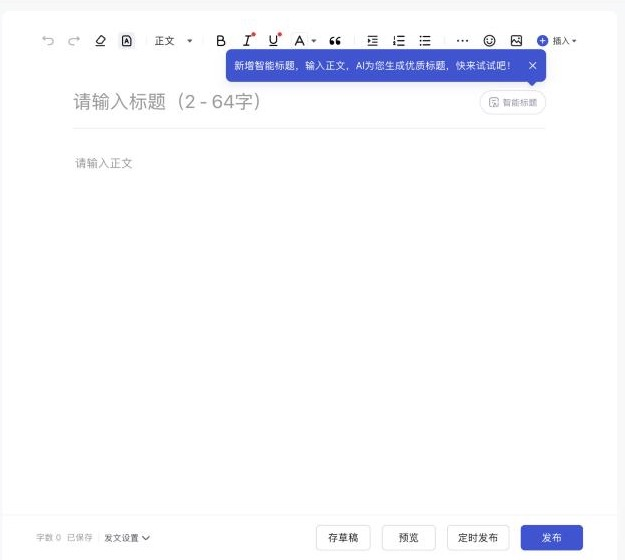
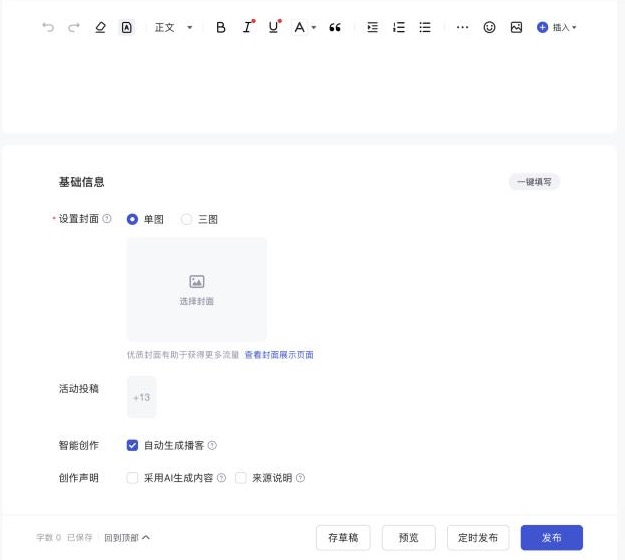

# 百家号（baijiahao）

调研日期：2026-10-29。资料来自公开资料和开源插件源码；登录后实测的内容记在文末「实测记录」，还没测的写「待实测」。

## 入口

| 项 | 值 |
|---|---|
| 登录 | `https://baijiahao.baidu.com/`（百度账号，个人注册后需审核） |
| 写图文 | `https://baijiahao.baidu.com/builder/rc/edit?type=news` |
| 登录检测 | `GET https://baijiahao.baidu.com/builder/app/appinfo` |
| 编辑令牌 | 编辑页 `window.__BJH__INIT__AUTH__`，或 `localStorage['edit-token']`，作为请求头 `token` |
| logo | `packages/logos`：`baijiahao-64.png` / `baijiahao-128.png` |

## 官方开放能力

| 能力 | 结论 |
|---|---|
| MCP | 未查到 |
| 官方发文 API | **有，个人作者可用**：「内容开放接口」，用 `app_id`（作者账号 ID）+ `app_token` 调用，不走 OAuth。前提是同意开发者规范、以自己名义开发、账号状态正常。申请入口的具体页面待实测 |
| Webhook / RSS 导入 | 未查到 |

官方接口（基址 `http://baijiahao.baidu.com`）：

| 能力 | 路径 |
|---|---|
| 发图文 | `/builderinner/open/resource/article/publish` |
| 发图集 | `/builderinner/open/resource/article/gallery` |
| 撤回 | `/builderinner/open/resource/article/withdraw` |
| 修改 | `/builderinner/open/resource/article/republish` |

**图文参数**
- `title`：必填，8–40 字。
- `content`：必填，富文本，不超过 20000 字。
- `origin_url`：必填，原文链接。
- `cover_images`：0–3 张，每张至少 218×146。不传封面时文章进草稿。
- `is_original`：1 表示原创，0 表示非原创。
- 官方接口**没有**摘要、标签、定时、分类这几个参数。

**错误码**
- `60001009`：今日可发篇数为 0。
- `60001008`：日发文数检查失败。
- `60000005`：账号未通过审核，或在禁言期。

**注意**
- 同一篇文章不能重复提交。
- 接口不得提供给其他产品使用。⚠️ 辰记作为第三方工具替用户调用是否合规，需要读原文确认；目前的思路是「用户自己申请 Token、填进辰记」。
- 第三方反馈：接口返回成功，后台却看不到文章。⚠️

## 编辑器与正文格式

- 标题是 contenteditable；正文是 UEditor，部分版本放在 iframe 里，接受 HTML。
- 图片必须转存到百度的域名下，以下域名不用转存：`baijiahao.baidu.com`、`bdstatic.com`、`bcebos.com`。
  - 上传接口：`POST /pcui/picture/uploadproxy`，参数 `media` / `type=image` / `save_material=1` / `article_type=news`。
  - 备用接口：`/materialui/picture/uploadProxy`。
- 代码块、表格、公式：未查到，待实测。

## 发布字段（网页端 `POST /pcui/article/save?callback=bjhdraft`）

| 字段 | 必填 | 接口字段 | 说明 |
|---|---|---|---|
| 标题 | 必填 | `title` | 官方接口要求 8–40 字；MultiPost 截到 64 字。⚠️ 两者冲突，待实测 |
| 正文 | 必填 | `content`、`len`（字数） | `type=news` |
| 封面 | 选填 | `cover_layout`（`one` 是单图，三图的值待实测）、`cover_images`、`vertical_cover`、`_cover_images_map`、`cover_source`、`is_auto_optimize_cover` | 先上传原图，再调 `/pcui/Picture/CuttingPicproxy` 裁出横版 1.5 和竖版 0.75 两种比例 |
| 摘要 | 选填 | `abstract`、`abstract_from` | |
| 副标题 | 选填 | `subtitle` | |
| 话题 | 选填 | `bjhtopic_id` / `bjhtopic_info` | 插件都留空 |
| 原创声明 | 选填 | `original_status` | 账号要有「图文原创」权限，否则报「声明原创失败」 |
| 首发 / 独家 | 选填 | `first_exclusive_publish_v2` | MultiPost 传 3，含义待实测 |
| 允许转载 | 选填 | `source_reprinted_allow` | |
| 功能开关 | 选填 | `activity_list`：`ttv`、`ai_tts`、`reward`、`aigc_bjh_status` | `aigc_bjh_status` ⚠️ 推测是 AI 生成声明 |
| 排版美化 | 选填 | `isBeautify`、`usingImgFilter` | |
| 定时发布 | 选填 | 待实测 | 易媒助手提到「定时发布后封面错位」，说明有这个功能 |

## 发布规则（官方手册）

**发文篇数**
- 新手期每天 5 篇，图文、图集、视频合计。审核没通过的也占名额。
- 获得原创标签后，每天 10 篇。

**转正**
- 条件：注册满 7 天，百家号指数 ≥ 500，信用分 100。
- 申请被拒后，第 1 次要等 15 天才能再申请，第 2 次要等 30 天，第 3 次起不能再主动申请。

**图文原创**
- 申请条件：已转正、已实名，质量分 ≥ 500，原创分 ≥ 800，近 30 天有 ≥ 10 篇原创图文获推荐，粉丝 ≥ 30。
- 滥用的后果：第一次被认定非原创，永久取消原创功能；第二次，封号。

**外链与引流**
- 禁止放带营销意图的公众号、二维码、电商链接、第三方网址。
- 辰记默认去掉外链，并提示用户。

**信用分**
- 初始 100 分，扣到 0 封停。
- 一次扣 50 分，同时禁言 5 天。
- 之后 7 天没有新违规的话，每天恢复 1 分。

## 风控与反爬

- 登录态：百度 cookie，常见是 `BDUSS` / `STOKEN`，⚠️ 待实测。
- 鉴权：请求头 `token`，并带 `Origin` / `Referer: https://baijiahao.baidu.com`。在桌面端页面内发请求，这两个头本来就对。
- 签名、验证码、频率限制：未查到。

## 插件对照

| 字段 | Wechatsync | MultiPost | COSE | 辰记现状 |
|---|---|---|---|---|
| 标题 / 正文 / 图片转存 | ✔ | ✔ | 标题、正文 | 没有适配器 |
| 封面 | — | ✔（单图，横竖两种裁剪） | — | — |
| 摘要 | — | ✔ | — | — |
| 原创 / 首发 / 功能开关 | 固定值 | 固定值 | — | — |
| 发布方式 | 只存草稿 | 存草稿 | 填表 | — |

## 辰记要做到的

**表单要能填的字段**
- 标题（8–40 字，校验）
- 正文（转存图片、去外链）
- 封面：单图 / 三图，横竖裁剪
- 摘要、副标题
- 原创声明（没有权限时提示）
- 首发
- 允许转载
- AI 生成声明
- 定时发布

**两种接入方式**
- 默认：桌面端发布台，填好以后由用户点发布。
- 另一种：用户自己申请官方 `app_token` 后，可以直接调官方接口发布。官方接口只支持标题、正文、封面、原创，用这种方式时要把这一点告诉用户。

## 待实测

- [ ] 网页端标题字数上限
- [ ] 三图封面 `cover_layout` 的值
- [ ] 定时发布的字段
- [ ] `first_exclusive_publish_v2` 的含义
- [ ] 开放接口申请入口，以及 `app_token` 在哪里查看
- [ ] 登录 cookie 名

## 实测记录

### 2026-10-29：新号（账号等级 V1，信用分 100，没做实名认证）

**编辑器**（`/builder/rc/edit?type=news`）
- 正文是 UEditor，放在 `iframe#ueditor_0` 里，实例是 `window.UE_V2.instants['ueditorInstant0']`。
- 标题占位文字「请输入标题（2 - 64字）」。**网页端上限 64 字，官方接口是 8–40 字**，两边不一样。
- 编辑令牌在 `localStorage['edit-token']` 里。
- 工具栏：撤销、重做、清除格式、格式刷、正文 / 标题、加粗、斜体、下划线、文字颜色、引用、缩进、有序 / 无序列表、更多、表情、图片、插入。
- 顶部可以切换体裁：图文、视频、动态、直播、合集、AI 成片。

**发布设置**（「基础信息」，在正文下方，有「一键填写」按钮）

| 字段 | 必填 | 形式 / 说明 |
|---|---|---|
| 设置封面 | ✔ | 单图 / 三图，「选择封面」，可以查看封面在各页面的展示效果 |
| 活动投稿 | — | 当前有 13 个活动可选（`author/eco/tasksystem/getSquareMissionList`） |
| 智能创作 | — | 「自动生成播客」，**默认勾选** |
| 创作声明 | — | 「采用AI生成内容」、「来源说明」两个复选框 |
| 原创声明 | — | 新号表单里**没有**。不过 `getabilityinfo` 里 `can_announce_original: true`，⚠️ 可能要等发了内容后才显示 |
| 摘要 | — | 表单里没有，页面会调 `writebrain/aihelper/sampling?type=abstract`（AI 摘要） |

底部按钮：存草稿、预览、**定时发布**、发布，另有「手机查看」。

**能力开关接口（对辰记最有用）**

`GET /author/eco/rights/getabilityinfo` 一次就能拿到这个账号开通了哪些能力，辰记可以据此决定表单里显示哪些项。当前账号的取值：

| 字段 | 值 | 含义 |
|---|---|---|
| `can_announce_original` | true | 能声明原创 |
| `aigc_creation_pc` | true | 能用 AI 创作 |
| `can_mount_goods` / `can_mount_shop` | false | 不能挂商品 |
| `can_pay_subscribe` | false | 不能开付费订阅 |
| `is_news_pay_user` | false | 不是图文付费作者 |
| `in_riding_wind*` | 0 | 没进「乘风计划」 |
| `can_text_to_video` | false | 不能图文转视频 |

**页面调用的接口**（全部在 `baijiahao.baidu.com` 下）
- 编辑页：`pcui/article/edit?type=news`
- 账号信息：`builder/app/appinfo`
- 话题权限：`pcui/topic/topicuserauthcheck`
- 合集列表：`pcui/group/groupmountlist`
- 位置列表：`pcui/videoMount/yxtLocationList`
- 会员信息：`author/eco/member/info`
- 名称检查：`userb/user/baseInfo/check`
- AI 助手：`writebrain/copilot/*`

**风控**
- 页面加载了百度的 ACS 反爬组件（全局变量有 `ACS_2083`、`ACS_2112`）。
- cookie 里有 `BAIDUID`、`BAIDUID_BFESS`、`PHPSESSID`、`ppfuid`、`XFI` / `XFCS` / `XFT`、`RECENT_LOGIN`、`RT`。`BDUSS` 是 httpOnly，页面读不到。
- 辰记只在页面里操作，和别的平台一样。

**官方通道（已确认）**

开发者文档：`/builder/author/openauth/openauthProtection`。
- 流程：同意开发者规范 → 拿到 `app_id` 和 `app_token` → 调接口 → 内容进百家号。
- 发图文接口：`http://baijiahao.baidu.com/builderinner/open/resource/article/publish`，参数和上文一致。标题 8–40 字，正文不超过 20000 字，富文本。封面 0–3 张，每张不小于 218×146，没传封面的进草稿箱。
- 文档里写明的规则：
  - 通过接口推送的篇数，**和作者每天的发文篇数共用同一个额度**。
  - 相同文章去重，不能重复提交。
  - 其他平台的推广信息会被屏蔽。
  - 「不得提供给其他产品使用」。
- 在账号设置页没找到 `app_token` 的申请或查看入口，⚠️ 待找。

**发布后的数据**（`/builder/rc/analysiscontent`，**每天更新前一天的数据**；作品发布满一天后才有数据）
- 整体数据，或按单篇看；可以按体裁分（图文、视频、动态等）。
- 指标：阅读 / 播放量、点击率、互动率、评论、点赞、收藏、分享、作品涨粉、作品掉粉、不感兴趣、**百度搜索量**。
- 还有条均数据、流量来源、投稿分析、作品诊断，都可以导出。
- 数据接口待实测，因为网络面板的缓冲被冲掉了。辰记做法：每天在页面内读一次。

**变现**（收入中心 `/builder/rc/incomecenter`）
- 收入类别：广告分成、度星选、付费内容、内容电商、内容分销、短剧、百享计划、内容赞赏、直播、付费咨询、付费圈子、其他。
- 当前提示「请完善财务信息」，财务信息在结算中心填。
- 各项的解锁条件（⚠️ 是从页面浮层读出来的，浮层可能被几项复用）：

| 变现方式 | 解锁条件 |
|---|---|
| 度星选招募、直播电商带货 | 粉丝 ≥ 10，成长坐标 ≥ 04，近 30 天发过图文或视频 |
| 度星选征文、付费内容、内容分销、**百享计划**（自然内容自动配广告分成） | 作者权益等级 V2，近 30 天发过内容，成长坐标 ≥ 04 |

**个人中心**（`/builder/rc/settings/accountSet`）
- 账号等级 V1，信用分 100。
- 「**实名认证未完成**」。
- 收益设置里有「广告设置」（内容挂广告）和「商品设置」（关联淘宝、京东、拼多多、度好货）。
- **百家号自己的「多平台关联同步」**：能把抖音、小红书等平台的内容自动同步到百家号。

**对辰记的影响**
- 用 `getabilityinfo` 决定表单显示哪些项：原创、挂商品、付费。
- 「自动生成播客」默认勾选。辰记沿用这个默认值，但要让用户看得到这一项。
- 「采用AI生成内容」：内容用了辰记 AI 时，建议默认勾上。
- 官方接口是一条可选通道。前提是用户自己去申请 `app_token`，而且它只支持标题、正文、封面和原创标记，额度和网页发文共用。
- 百家号能从小红书、抖音自动同步。在辰记里，可以提示用户「已经发了小红书的话，可以用百家号的关联同步」。

## 来源

- 官方接口文档：https://baijiahao.baidu.com/builder/author/openauth/openauthProtection
- 官方手册：https://baijiahao.baidu.com/builder/author/info/manual
- Wechatsync v2：https://github.com/wechatsync/Wechatsync/blob/v2/packages/core/src/adapters/platforms/baijiahao.ts
- MultiPost：https://github.com/leaperone/MultiPost-Extension/blob/main/src/sync/article/baijiahao.ts
- 易媒助手帮助中心：https://www.yimeizhushou.com/help.html
- 第三方反馈（接口成功但后台不见）：izualzhy.cn ⚠️
