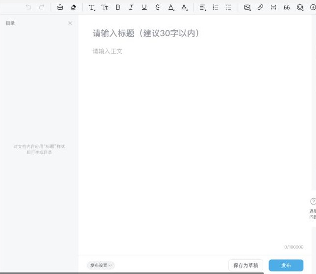
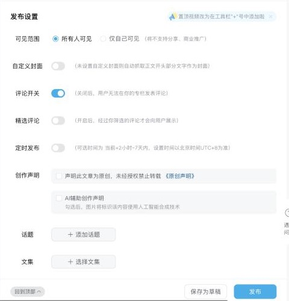

# B 站专栏 / 图文（bilibili）

调研日期：2026-10-29。资料来自公开资料和开源插件源码。登录后实测的内容记在「实测记录」，还没测的标「待实测」。

## 入口

| 项 | 值 |
|---|---|
| 登录 | `https://passport.bilibili.com/login`（扫码 / 手机号） |
| 新版图文（opus） | `https://member.bilibili.com/platform/upload/text` |
| 旧版专栏编辑器 | `https://member.bilibili.com/article-text/home?newEditor=-1` |
| 登录检测 | `GET https://api.bilibili.com/x/web-interface/nav`（看 `isLogin`） |
| logo | `packages/logos`：`bilibili.svg` |

## 官方开放能力

| 能力 | 结论 |
|---|---|
| MCP | 未查到 |
| 专栏 / 图文的官方发布 API | **没有**。开放平台 `openhome.bilibili.com` 能确认的只有视频投稿（`client_id` / `access_token`）⚠️ |
| Webhook / RSS 导入 | 未查到 |

另外，社区文档 bilibili-API-collect 已在 2026-01 因法律投诉归档并删除，不能再依赖。

## 编辑器与正文格式

- **旧版专栏**：编辑器是 UEditor，接受 HTML。
- **新版图文**：草稿正文是结构化 JSON，不是 HTML。
  - 正文放在 `opus.content.paragraphs[]`，每段由 `para_type` 加 `text.nodes[]` 组成。
  - 要从 Tiptap 转过来，需要单独写一个渲染器。
- **图片**：必须先传到 B 站 CDN（`hdslb.com` / `biliimg.com`）。上传接口有两个：
  - `POST https://api.bilibili.com/x/article/creative/article/upcover`，参数 `binary` + `csrf`。
  - `POST https://api.bilibili.com/x/dynamic/feed/draw/upload_bfs`，参数 `file_up`、`biz=new_dyn`、`category=daily`、`csrf`。
- **外链**：插件会把正文里的链接全部去掉（Wechatsync 的 `removeLinks`）。
- **代码块 / 表格 / 公式**：待实测。

## 发布字段

旧接口：`POST https://api.bilibili.com/x/article/creative/draft/addupdate`

| 字段 | 必填 | 接口字段 | 说明 |
|---|---|---|---|
| 标题 | 必填 | `title` | 页面建议 30 字以内，MultiPost 截到 40 字 |
| 正文 | 必填 | `content`、`words` | |
| 封面 | 选填 | `banner_url` | 先上传到 BFS 拿到地址；尺寸待实测 |
| 摘要 | 选填 | `summary` | |
| 标签 | 选填 | `tags` | 多个标签用逗号分隔 |
| 分类 | 选填 | `tid` / `category` | |
| 原创 / 转载 | 选填 | `original`、`reprint`（0 = 原创，1 = 转载） | |
| 文集 | 选填 | `list_id` | |
| 动态文案 | 选填 | `dynamic_intro` | |
| 剧透 | 选填 | `spoiler` | |
| 草稿 / 发布 | — | `save` | 含义待实测 |

新版图文：`POST /x/dynamic/feed/article/draft/add?csrf=&w_rid=&wts=`，主要字段如下：

- `arg.type=4`
- `template_id`、`category_id`
- `title`、`summary`
- `private_pub`：仅自己可见
- `reprint`、`original`、`list_id`
- `opus{ opus_source, title, content.paragraphs, pub_info.editor_version }`

评论开关、定时发布、AI 声明对应哪个字段：待实测。

## 发布规则

- **门槛**：等级不够不能发专栏。新号要先在手机上答题转正（易媒助手）。
- **频率**：新号往往每天只能发 1 篇专栏。⚠️ 官方数值未查到。
- **错误码 352**：新号、换网络或换设备时常见。处理办法是先手动发一篇专栏，通过验证，连续这样做 3–5 天。
- **审核与引流**：专栏专门的规则未查到。

## 风控与反爬

- **登录 cookie**：`SESSDATA`；`bili_jct` 同时也是 CSRF，作为表单字段 `csrf` 传；`buvid3`。
- **请求头**：`Origin` / `Referer` 是 `https://member.bilibili.com`。在桌面端页面内发请求时，这两个头天然就对。
- **签名**：
  - 旧接口 `addupdate` 在插件里不带签名。
  - 新版图文接口带 wbi 签名（`w_rid` + `wts`）。必须在页面内由页面自己的 JS 生成，辰记不复刻签名算法。
- **风控**：出现 352 或「需要验证之后再发布」时，交给用户在页面里处理。

## 插件对照

| 字段 | Wechatsync | MultiPost | COSE | 辰记现状 |
|---|---|---|---|---|
| 标题 / 正文 / 图片转存 | ✔ | ✔ | 标题、正文 | 没有适配器 |
| 封面 | — | ✔ | — | — |
| 摘要 | — | ✔ | — | — |
| 标签 | — | ✔ | — | — |
| 分类 | 固定 `tid=4` | ✔ | — | — |
| 原创 / 转载 | — | ✔ | — | — |
| 发布方式 | 只存草稿 | 存草稿 | 点「存草稿」 | — |

## 辰记要做到的

- **表单字段**：标题、正文（图片转存、去外链）、封面、摘要、标签、分类、原创 / 转载、文集、动态文案、仅自己可见。
- **编辑器优先级**：优先支持新版图文编辑器，旧专栏编辑器作为备用。
- **发布方式**：默认交接到发布台，由用户自己点发布。
- **新号提醒**：新号先提示「需要答题转正」和「每天大约只能发 1 篇」。

## 待实测

- [ ] 新版图文编辑器现在是否是默认入口；旧专栏编辑器是否还能用
- [ ] 标题和摘要的字数上限、封面尺寸
- [ ] 评论开关、定时发布、AI 声明对应的字段
- [ ] `save` 的含义
- [ ] 分类列表从哪个接口取

## 实测记录

### 2026-10-29：专栏投稿（老账号，注册约 2015 天）

**入口和每日上限**
- 「专栏投稿」入口是 `/platform/upload/text`。页面本身是外壳，草稿箱放在 iframe `member.bilibili.com/york/read-draft` 里。
- 页面上写明的规则：
  - 图片只支持 .jpg / .png / .webp / .gif / .heif，静态图不超过 20M，gif 不超过 8M。
  - **账号要 LV1 以上才能发专栏。LV1–3 每天 1 篇，LV4–6 每天 5 篇。**

**编辑器**
- 点「新的创作」会跳到 `/platform/upload/text/new-edit`，编辑器在 iframe `member.bilibili.com/york/read-editor` 里。
- **新版专栏编辑器用的是 tiptap / ProseMirror**（`.tiptap.ProseMirror.eva3-editor`），已经不是 UEditor。
  - 存草稿走 opus 接口：`x/dynamic/feed/create/opus_init_check?editor_version=&w_rid=&wts=`，**带 wbi 签名**。
  - 正文会存成 opus 结构，所以辰记要在页面内往编辑器里填内容，由页面自己完成转换和签名。
- 标题框是 `textarea`，占位文字「请输入标题（建议30字以内）」，`maxLength` 为 **50**。
- 正文最多 100000 字。左侧会根据标题样式自动生成目录。
- 工具栏：撤销、重做、格式刷、清除格式、标题、字号、加粗、斜体、下划线、删除线、文字颜色、背景色、对齐、有序 / 无序列表、图片、链接、分割线、引用、表情、「+」插入（置顶视频等）。

**发布设置**（在正文下方）

| 字段 | 默认 | 说明 |
|---|---|---|
| 可见范围 | 所有人可见 | 也可以选「仅自己可见」，选了就不支持分享和商业推广 |
| 自定义封面 | 关 | 不设置时，会自动截取正文开头的文字生成封面 |
| 评论开关 | **开** | 关掉后用户不能评论 |
| 精选评论 | 关 | 开了以后，只有你筛选过的评论才会显示 |
| 定时发布 | 关 | **只能选当前时间之后 2 小时到 7 天内**，按北京时间 |
| 创作声明 | 不勾 | 「声明此文章为原创，未经授权禁止转载」 |
| AI 辅助创作声明 | 不勾 | 勾了以后，图片上会标注「使用人工智能合成技术」 |
| 话题 | — | 添加话题 |
| 文集 | — | 选择文集 |

底部只有两个按钮：保存为草稿、发布。

**旧版专栏里的「分类」和「标签」都没有了。** MultiPost 等插件填的 `tid`、`tags` 还是旧接口的字段，新版已经不用了。

**风控**
- 能读到的 cookie 有：`bili_jct`（CSRF）、`DedeUserID`、`buvid3`、`buvid4`、`buvid_fp`、`_uuid`、`b_nut`、`bili_ticket`、`sid`。`SESSDATA` 是 httpOnly，读不到。
- 页面会拉风控配置 `x/web-frontend/risk/config`。
- 大部分接口都带 `x-bili-device-req-json` 和 `x-bili-locale-json`。
- opus 相关的接口要 wbi 签名（`w_rid`、`wts`）。

**发布后的数据**

数据中心 `/platform/data-up/`，iframe 是 `york/data-center-web`。**每天中午 12 点（北京时间）更新前一天的数据**，第一次发稿后，从第二天开始才有数据。

| 页面 | 接口 |
|---|---|
| 核心数据概览：播放、空间访客、净增粉丝、点赞、收藏、硬币、评论、弹幕、分享 | `member.bilibili.com/x/web/data/v2/overview/stat/num?period=&tab=&tmid=` |
| 收益数据（充电） | `x/web/data/v3/overview/elec/num`、`elec/graph` |
| 专栏数据 | 「专栏数据」页签，接口待实测 |
| 账号诊断、稿件分析 | `x/web/data/account_diagnose/*`、`archive_diagnose/*` |

公开数据可以作为兜底：⚠️ 专栏 / opus 的公开详情接口应该能读到阅读、点赞、评论、收藏、硬币、分享，待实测。

**变现**（收益管理）
- 侧栏入口有：收益中心、**创作激励**、UP动画、**充电计划**、悬赏带货、任务广场、花火平台（商单）、模板激励。
- 创作激励（`/platform/allowance/excitation/pc`）只有「视频激励」和「素材激励」两种，**专栏没有激励**。加入条件：
  - 权益等级 LV3（这个号未达标）；
  - 创作信用分（页面显示 80 分，标为未达标）。
- 专栏能拿到的收益：
  - 充电：读者给 UP 主充电；
  - 悬赏带货、花火商单：有合作时才有；
  - 活动和任务奖励。
- 「创作权益」里还有版权保护计划，会自动监测站外搬运并帮你维权。

**对辰记的影响**
- 适配器按新版编辑器来做：在 `york/read-editor` 这个 iframe 里填内容，表单字段按上表。不要再填旧版的分类和标签。
- 标题按 50 字截断，超过 30 字时提示「建议 30 字以内」。
- 定时发布要校验在 2 小时到 7 天之间。
- 先看账号等级。LV0 不能发；LV1–3 每天 1 篇，要提醒用户。
- 「AI 辅助创作声明」由用户自己勾选，辰记不预设。

## 来源

- Wechatsync v2：https://github.com/wechatsync/Wechatsync/blob/v2/packages/core/src/adapters/platforms/bilibili.ts
- MultiPost：https://github.com/leaperone/MultiPost-Extension/blob/main/src/sync/article/bilibili.ts
- COSE：https://github.com/doocs/cose
- 新版图文抓包笔记（Bilibili-Gate）：https://github.com/magicdawn/Bilibili-Gate/blob/main/src/modules/bilibili/me/article-draft/api/_note.md
- 易媒助手帮助中心：https://www.yimeizhushou.com/help.html
