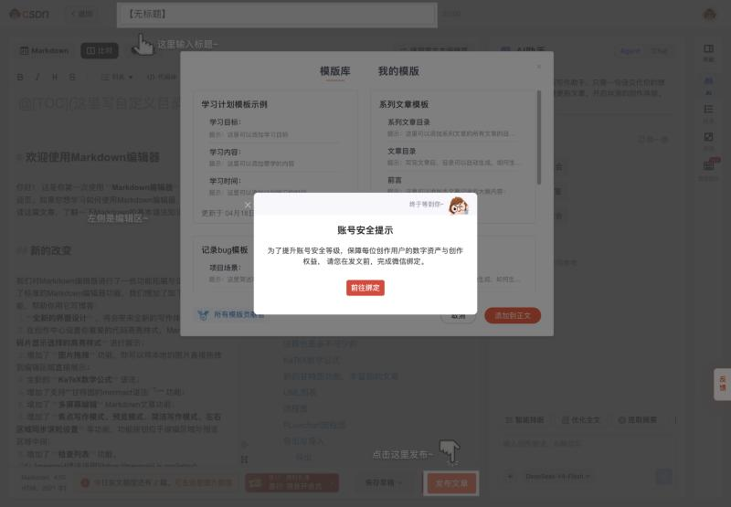
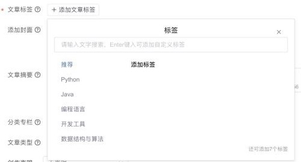

# CSDN（csdn，适配器 `@starnote/publish-csdn`）

调研日期：2026-10-29。资料来自公开资料和开源插件源码。登录后实测的结果记在「实测记录」，还没测的项写「待实测」。

## 入口

| 项 | 值 |
|---|---|
| 登录 | `https://passport.csdn.net/login`（扫码 / 手机验证码 / 密码 / 第三方） |
| Markdown 编辑器 | `https://editor.csdn.net/md/` |
| 富文本编辑器 | `https://mp.csdn.net/mp_blog/creation/editor`（CKEditor） |
| 创作中心 | `https://mp.csdn.net/` |
| 登录检测 | `GET https://bizapi.csdn.net/blog-console-api/v3/editor/getBaseInfo`（要签名，见下文）。站点脚本里写的是旧接口 `me.csdn.net/api/user/show`，待实测 |
| logo | `packages/logos`：`csdn.svg` |

## 官方开放能力

MCP、发布 API、Webhook、RSS 导入都没有。`bizapi.csdn.net` 是编辑器内部用的接口，不对外开放。

## 编辑器与正文格式

- Markdown 编辑器：保存时同时提交 `markdowncontent` 和 `content`（HTML）。
- 富文本编辑器：CKEditor Classic，只能通过 `setData()` 写入内容；直接改 DOM 的话，保存后内容是空的。
- 图片要转存到 CSDN 的华为云 OBS：
  1. 先取签名：`POST bizapi.csdn.net/resource-api/v1/image/direct/upload/signature`。站点脚本用的是 `imgservice.csdn.net` 的上传策略。
  2. 再用 multipart 上传到 OBS。
- 代码块、表格：Markdown 原生支持。公式待实测。

## 发布字段

接口：`POST https://bizapi.csdn.net/blog-console-api/v3/mdeditor/saveArticle`（MultiPost 用的是 `v1/postedit/saveArticle`）。

| 字段 | 必填 | 接口字段 | 限制 | 辰记现状 |
|---|---|---|---|---|
| 标题 | 必填 | `title` | 5–100 字 | ✔ |
| 正文 | 必填 | `markdowncontent` + `content` | | ✔ |
| 摘要 | 选填 | `description` | MultiPost 截到 256 字 | 待核对 |
| 标签 | **发布必填** | `tags`（逗号分隔） | 站点脚本上限 5 个；MultiPost 没填时默认「经验分享」 | 待核对 |
| 分类专栏 | 选填 | `categories` | | 待核对 |
| 文章类型 | 必填 | `type`：`original` / `repost` / 翻译（⚠️ 翻译的取值待实测） | | 待核对 |
| 转载来源 | 转载时必填 | `original_link` | | 待核对 |
| 可见范围 | 选填 | `readType`：`public`，其他取值（私密 / 粉丝 / VIP）待实测 | | 待核对 |
| 封面 | 选填 | `cover_images[]`、`cover_type` | 比例待实测 | 待核对 |
| 定时发布 | 选填 | `scheduled_time`（秒级时间戳） | | 待核对 |
| 创作活动 | 选填 | `creator_activity_id` | | — |
| 状态 | — | `status`、`pubStatus:"draft"` | | — |

辰记的 CSDN 适配器把字段映射写在 `render.ts` / `electron.ts` 里，站点脚本里没有。上表「待核对」各行，下一步对照代码补上。

## 发布规则

- 每日篇数说法互相矛盾，**不要写死**，以发布时页面实际提示为准：
  - 旧资料：普通用户 10 篇，VIP 20 篇。
  - 2026 年文章：非会员每天最多 3 篇。⚠️
- 发布后要审核。

## 风控与反爬

- 登录态 cookie：`UserToken`（站点脚本用它判断是否登录成功）、`dc_session_id`、`p_uid`、`uuid_tt_dd`。
- **`bizapi` 是 API 网关签名**：请求头要带 `x-ca-key`、`x-ca-nonce`、`x-ca-signature`（HMAC-SHA256）、`x-ca-signature-headers`。
  - key 和 secret 是 CSDN 前端 JS 里的公开常量。
  - **辰记不复刻签名**：在 `editor.csdn.net` 页面里发请求，让页面自己的请求封装加签。
  - 如果现在的适配器是用 `session.fetch` 直接发的，要实测是否会被拒。
- `Origin` / `Referer` 必须是 `https://editor.csdn.net`。
- 有无头浏览器检测：无头浏览器打开编辑页会被跳转到倒计时页。桌面端用的是正常窗口，不受影响。

## 插件对照

| 字段 | Wechatsync | MultiPost | COSE | 辰记现状 |
|---|---|---|---|---|
| 标题 / 正文 / 图片转存 | ✔ | ✔ | ✔（Markdown） | ✔ |
| 摘要 / 标签 / 分类专栏 | 空 | ✔ | — | 待核对 |
| 原创 / 转载 | 固定 original | ✔ | — | 待核对 |
| 封面 / 定时 | — | ✔ | — | 待核对 |
| 可见范围 | 固定 public | 固定 public | — | 待核对 |
| 发布方式 | 草稿 | 建好后跳到编辑页 | 填好表单 | 发布台（填好内容，由用户点发布） |

MultiPost 是 CSDN 上填得最全的插件，辰记至少要和它一样。

## 辰记要补的

- 表单字段：
  - 标签（必填，最多 5 个）
  - 分类专栏（列出用户已有的专栏）
  - 文章类型：原创 / 转载 / 翻译；选转载时要填原文链接
  - 可见范围
  - 封面
  - 摘要
  - 定时发布
  - 创作活动
- 遇到「发文上限」提示时，原样显示给用户。

## 待实测

- [ ] 每日篇数上限
- [ ] 标签上限
- [ ] `readType` 的取值
- [ ] 封面比例
- [ ] `session.fetch` 不加签直接调 `saveArticle` 会不会被拒
- [ ] 登录检测用哪个接口

## 实测记录

### 2026-10-29：Markdown 编辑器（新注册账号，桌面宽度 1440）

**第一次打开编辑器**会依次弹出：
1. 新手引导（「这里输入标题」「左侧是编辑区」「点击这里发布」）
2. 模版库
3. **「账号安全提示：为了提升账号安全等级……请您在发文前，完成微信绑定」**，并附「前往绑定」按钮，指向 `i.csdn.net/#/user-center/account/bind`

**新号不绑定微信就不能发文。**
- 辰记的绑定流程里要先检查这一项，没绑定时提示用户自己去绑。
- 辰记不代替用户绑定。

**在内嵌浏览器里点「绑定」没有反应**

- 位置：`i.csdn.net/#/user-center/account/bind` 的「微信 → 绑定」。
- 现象：点击后没有弹窗，也没有调用 `window.open`。控制台反复出现「document.domain mutation is ignored because the surrounding agent cluster is origin-keyed」，另有一个 400 错误。
- 原因：CSDN 的跨子域通信还依赖修改 `document.domain`，而 Chromium / Electron 默认按源隔离（origin-keyed agent cluster），这种修改会被忽略。

**对辰记桌面端的影响**
- 辰记发布台也是 Electron，CSDN 的账号设置这类页面可能同样用不了。
- 绑定微信这类账号操作，请用户在自己的浏览器或 CSDN App 里完成。
- 编辑器和发布接口不受影响，以实测为准。

**编辑器**
- `editor.csdn.net/md/`：正文区是 `.editor__inner[contenteditable=true]`，没有用 CodeMirror。
- 新文章正文默认带一篇「欢迎使用 Markdown 编辑器」的示例。辰记填正文时要**整篇替换**，不能接在后面。
- 标题输入框是 `.article-bar__title--input`，占位文字「请输入文章标题（5~100个字）」，`maxLength` 为 100，与站点脚本一致。
- 工具栏有：加粗、斜体、标题、删除线、列表、待办、代码块（可选 40 多种语言）、引用、代码运行、资源绑定、视频、表格、图片、超链接、目录、模版、导入 / 导出、历史版本、AI、营销组件。
- 底部按钮：「保存草稿」「发布文章」。
- 右上角可以切换到「使用富文本编辑器」。

**页面调用的接口**
- 都在 `bizapi.csdn.net` 下。
- 新版控制台的前缀是 `/blog/phoenix/console/v1/`；旧的 `blog-console-api/v3/` 还在用。

| 用途 | 接口 |
|---|---|
| 用户基础信息（可用来检测登录） | `blog-console-api/v3/editor/getBaseInfo` |
| 写作配置 | `phoenix/console/v1/write/get-config` |
| 权限列表 | `phoenix/console/v1/user/list-permission` |
| 是否零文章用户 | `phoenix/console/v1/article/is-zero-article-user` |
| 编辑器模版 | `phoenix/console/v1/editModel/findPublicShowEditModels` |

### 2026-10-29：绑定微信之后的发布设置（同一账号）

- 绑定微信以后，编辑器不再弹安全提示。
- 底部状态栏显示「**今日发文额度还有 2 篇**，可去这里提升额度」。注意：等级权益页上写的是 LV.1 每天 1 篇，和这里不一致，⚠️ 待核对。
- 新文章的默认标题是「【无标题】」。编辑器会自动保存，保存后地址变成 `editor.csdn.net/md?articleId={id}`。

**发布弹窗**
- 点「发布文章」会弹出「发布文章」对话框。
- 底部四个按钮：取消、保存为草稿、**定时发布**、发布文章。

| 字段 | 必填 | 形式 / 取值 |
|---|---|---|
| 文章标签 | ✔ | 搜索；按回车可以添加自定义标签。分类推荐有 Python、Java、编程语言、开发工具、数据结构与算法等。**提示「还可添加 7 个标签」**，站点脚本里写的 `tagsMax: 5` 要改成 7。推荐标签来自 `phoenix/console/v1/tag/get-recommend-tags` |
| 添加封面 | — | 本地上传；也会从正文图片里给出候选封面 |
| 文章摘要 | — | 最多 256 字，可以点「AI 提取摘要」。不填时自动取正文前 256 字 |
| 分类专栏 | — | 选已有专栏，或新建分类专栏 |
| 文章类型 | ✔ | 原创（默认）/ 转载 / 翻译 |
| 创作声明 | — | 无声明 / 部分内容由AI辅助生成 / 内容来源网络，进行整合/再创作 / 个人观点，仅供参考 |
| 文章备份 | — | 同时备份到 GitCode（勾选后会自动创建 GitCode 账号） |
| 可见范围 | — | 全部可见 / 仅我可见 / 粉丝可见 / VIP可见 |
| 文章模板 | — | 默认模板 / 简洁模板 / 墨衍模板 |
| 多平台发布 | — | 否 / 是，见下文 |
| 参与活动 / 话题 | — | 两个下拉框。活动列表来自 `phoenix/console/v1/write-active/list` |

**CSDN 自己的「多平台发布」：直接竞品**

选「是」以后会展开一个「多平台发布」面板，提示「安装插件后，可同时选择文章与 AI 图文同步平台」。
- 插件叫「CSDN同步助手」，地址 `sync.csdn.net`。没装插件时点同步平台，会提示「请安装或更新多平台发布插件后重试」。
- 面板有「文章同步」和「AI 图文同步」两个页签。
- 「文章同步」支持 16 个平台，每个后面都有「去登录」：微信公众号、微博、知乎、掘金、百家号、博客园、抖音长文、小红书长文笔记、头条、51CTO、简书、思否、开源中国、哔哩哔哩、腾讯云开发者社区、阿里云开发者社区。

这正是辰记的直接竞品，而且做在国内最大的开发者平台里面。辰记要在两点上超过它：
- 字段填得比它全；
- 发布后的数据能收回来（见下文「多平台同步数据」）。

**页面调用的接口**
- 自动保存草稿仍然走 `blog-console-api/v3/mdeditor/saveArticle`。
- 另外还会调用：
  - `phoenix/console/v1/history-version/save`（历史版本）
  - `article/get-quality-score`（质量分）
  - `template/list`（模板列表）

**发布后的数据**

- 入口：创作中心 → 数据 → 作品数据，地址 `/mp_blog/analysis/article/all`。**每天中午 12:00 更新前一天的数据。**

| 内容 | 接口 |
|---|---|
| 汇总：文章总数、展现量、点赞、阅读、评论、收藏 | `phoenix/console/v1/data/blog-statistics` |
| 文章列表与趋势 | `phoenix/console/v1/data/all-article?page=&size=&start=&end=&type=&action=` |
| 百度热搜词（文章能被哪些词搜到） | `phoenix/console/v1/data/baidu-keywords?type=&days=` |
| 单篇分析、导出数据 | 页面上有入口 |

- 同一个页面上还有一块「**多平台同步数据**」：
  - 按平台汇总 CSDN、公众号、微博的同步文章数、阅读、转发、点赞、收藏、评论。
  - 下面是同步明细，每条可以点「录入地址」，粘贴在其他平台发出的链接。
  - 新号目前显示的是示例数据。
  - 这和辰记「我的传播」的思路一样。

- 辰记的做法：给 CSDN 适配器实现 `fetchStats`，桌面端在 CSDN 页面内读 `data/all-article`（这个接口要签名，只能在页面内调用）。数据每天只更新一次，所以每天采一次就够了。

**变现**

| 方式 | 入口 | 怎么开通 |
|---|---|---|
| 博文打赏 | `/mp_blog/tools/rewardToMe` | 页面上直接「开启 / 关闭」，可以写打赏描述（最多 15 字） |
| 现金收益 | `i.csdn.net/#/wallet/income/center_cash`（创作中心「收益数据」页嵌的就是它） | 显示可提现、冻结、累计收益，可以申请提现 |
| 微权益值收益 | 收益数据页的页签 | 待看 |
| VIP 可见文章 | 发布时把可见范围选成「VIP可见」 | 分成规则待查 ⚠️ |
| 打卡激励、创作活动 | `/activity/writing_signin`、发布时选择活动 | 参加即可 |
| 付费专栏 | 专栏管理 | 门槛待查 ⚠️ |
| 流量券 | 升级时赠送 | 用来给文章买曝光，不是收入 |

**博客等级**（`/mp_blog/creator-plan/level`）共 LV.1–LV.10，按「博客积分」升级。这个号现在是 0 分，到 LV.2 要 100 分。

| 等级 | 每日发文上限 | 主要权益 |
|---|---|---|
| LV.1–2 | 1 篇 | 等级皮肤、流量券、VIP 优惠券 |
| LV.3–5 | 3 篇 | **自定义标签功能**；LV.4 起可以申请「新星创作者」认证 |
| LV.6–10 | 5 篇 | 自定义域名；LV.6 起可以申请「优质创作者」认证；LV.8 起可以申请「领域专家」认证；LV.7 起可以参加官方共创活动 |

对辰记有直接影响的有三点：
- **每日篇数跟着等级走**。辰记要从页面读出「今日发文额度还有 N 篇」，不能写死。
- **自定义标签要 LV.3 才有**。低等级账号只能从推荐的标签里选。
- **打赏是账号级的开关**，不在单篇文章里设置。辰记只要在绑定页提示用户去开启。

**cookie**
- 页面能读到 `UserName`、`UserNick`、`p_uid`、`uuid_tt_dd`、`dc_session_id`、`dc_sid`、`AU`、`UN`、`BT` 等。
- `UserToken` 是 httpOnly，页面读不到，属于正常情况。
- 站点脚本里用旧接口 `me.csdn.net/api/user/show` 检测登录，可以改成 `getBaseInfo`。`getBaseInfo` 需要网关签名，**必须在 CSDN 页面内调用**，由页面自己加签。

## 来源

- Wechatsync v2：https://github.com/wechatsync/Wechatsync/blob/v2/packages/core/src/adapters/platforms/csdn.ts
- MultiPost：https://github.com/leaperone/MultiPost-Extension/blob/main/src/sync/article/csdn.ts
- COSE：https://github.com/doocs/cose/blob/main/packages/core/src/platforms/csdn.js
- 第三方文章：
  - https://juejin.cn/post/7666771393114062894
  - https://blog.csdn.net/2401_88405924/article/details/144624935
