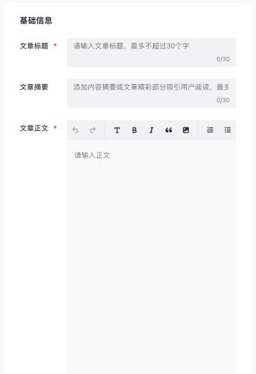
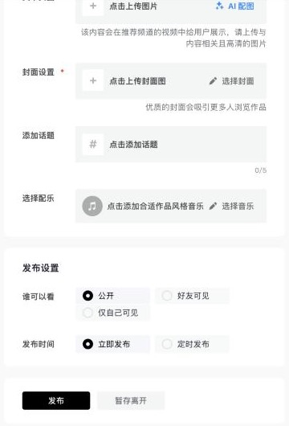
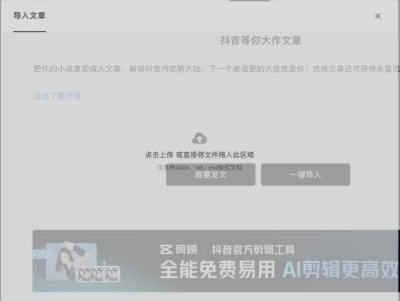

# 抖音（douyin）：文章、图文

调研日期 2026-10-29。资料来源：实测，以及公开资料。⚠️ 表示没有实测，只有公开说法。

## 入口

| 项 | 值 |
|---|---|
| 登录 | `https://creator.douyin.com/`（扫码或手机号） |
| 发布页 | `/creator-micro/content/upload?default-tab=1..5`，分「发布视频」「发布图文」「发布全景视频」「**发布文章**」四个页签 |
| 文章编辑器 | `/creator-micro/content/post/article`。注意：在内嵌浏览器里点「我要发文」会弹窗跳转，被拦截了，直接打开这个地址就行 |
| 收入变现 | `/creator-micro/revenue/center` |
| logo | `packages/logos`：`douyin.svg` |
| 辰记现状 | 注册表里已登记（`contentTypes` 是视频和图集），没有适配器 |

## 官方开放能力

- 抖音开放平台（`developer.open-douyin.com`）有「发布内容到抖音」的能力：视频、图集，通过分享 SDK 或 OpenAPI。⚠️ 需要以开发者应用的身份申请，并通过审核。网站应用的「代替用户发布」只开放给党政机关和事业单位（r13 调研）。**个人作者不能用它直接发「文章」。**
- 没有 MCP，没有面向个人的 Webhook。
- 结论：文章和图文都走桌面端的登录态，用发布台发。

## 发布文章（实测）

| 字段 | 必填 | 说明 |
|---|---|---|
| 文章标题 | ✔ | `input`，最多 **30** 字 |
| 文章摘要 | — | 最多 **30** 字，提示「添加内容摘要或文章精彩部分吸引用户阅读」 |
| 文章正文 | ✔ | tiptap / ProseMirror，**计数显示 0/20000**；首页入口写的是「支持 8000 字图文」，两处说法不一样 ⚠️ |
| 文章头图 | — | 上传图片或用「AI 配图」，会出现在推荐频道的视频流里 |
| 封面设置 | ✔ | 上传封面图，或「选择封面」 |
| 添加话题 | — | 最多 **5** 个 |
| 选择配乐 | — | 给文章配背景音乐 |
| 谁可以看 | — | 公开 / 好友可见 / 仅自己可见 |
| 发布时间 | — | 立即发布 / **定时发布** |

- 底部按钮：发布、暂存离开。
- 右边可以预览两种样式：「首页推荐」和「双列封面」，各自分有头图和无头图。
- 正文工具栏：撤销、重做、标题、加粗、斜体、引用、图片、有序 / 无序列表。

**「一键导入」：支持上传 docx、txt、md 文件**（发布文章页签里的「导入文章」）。辰记可以把笔记导出成 `.md`，放进这个文件上传框，比往编辑器里粘贴稳定。

## 风控（实测）

- 页面加载了字节系的安全组件：`bdms`、`secsdk`、`_SdkGlueInit`、`useWebSecsdkApi`。
- **创作者中心的大多数接口都带 `msToken` 和 `a_bogus`**，比如 `web/api/creator/*`、`aweme/v1/creator/*`、`web/api/media/anchor/search`、`aweme/mid/video/sts2/`。比头条号和掘金更严。
- 结论：辰记只在页面上填写，填完由用户自己点「发布」。导入 md 文件走页面上的文件上传框，签名交给页面自己完成。

## 发布后的数据

- 首页的「数据中心」**每天 12 点更新**，统计周期是一周。
- 账号总览：播放量、主页访问量、作品点赞、作品分享、作品评论、净增粉丝。另有「近期作品」「直播数据」两个页签。
- 单篇文章的数据在「内容管理」或「数据中心」里，接口待实测。这些接口都要签名，只能在页面里读。

## 变现

- 「收入变现 → 我的变现」显示昨日 / 近 7 日 / 近 30 日 / 累计收入和可提现金额，下面有「变现设置」入口。
- 「变现广场」**接任务之前要先入驻巨量星图**。入驻需要同意服务协议和隐私政策，并授权昵称、头像、地区、性别和手机号。这一步由用户自己决定，辰记不代办。
- **2026-10-29 用户已入驻星图**。入驻后，「变现广场」出现了几个分类页签：我可投稿、我可报名、好物测评、高收益、保底收入、合作过，还有「更多筛选」。
  - 现在页面提示「暂无商单，你可通过以下方式涨粉后，解锁新商单」：发布新作品，或者学习涨粉课程。
  - 移动端另外有变现任务，用抖音 App 扫码参与。
- 首页提示「可参与任务 0 个，先去提升粉丝量吧」，所以接任务有粉丝门槛 ⚠️，具体数值待查。
- 文章页签上写着「优质文章还可获得丰富流量奖励」，这是流量奖励，不是现金。

## 实测记录

### 2026-10-29（老账号，8 个粉丝）

- 只打开了发布页、文章编辑器、导入弹窗和收入变现页，**没有输入内容，也没有上传文件**。没有点星图入驻。
- 截图都裁掉了右侧预览里的抖音昵称。

## 辰记要做到的

- 新增 `douyin-article`（文章），和图文（`image-set`）、视频分开登记，做法同小红书的拆分。
- 文章：
  - 标题 30 字、摘要 30 字，正文按 2 万字截断。
  - 封面必填，头图可选，话题最多 5 个，另有可见范围和定时发布。
  - 正文优先用「导入 .md」，失败了再往编辑器里粘贴。
- 图文：用辰记的卡片版式生成图片后上传，表单字段待实测。
- 绑定页提醒用户：接任务要先入驻星图，而且有粉丝门槛。
