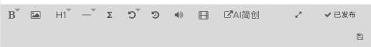

# 简书（jianshu）

调研日期 2026-10-29。资料来自实测和公开资料，⚠️ 表示没有实测、只有公开说法。

## 入口

| 项 | 值 |
|---|---|
| 登录 | `https://www.jianshu.com/sign_in`（手机验证码或第三方账号） |
| 写文章 | `https://www.jianshu.com/writer#/`，打开文章后地址是 `#/notebooks/{文集id}/notes/{文章id}` |
| logo | `packages/logos`：`jianshu-64.png` / `jianshu-128.png` |
| 辰记现状 | 只有 logo，注册表里没登记，也没有适配器 |

## 官方开放能力

MCP、发布 API、Webhook 都没有。简书一直没有开放平台。所以只能走桌面端登录态，用发布台。

## 编辑器与正文格式

- 写作页是三栏：**文集**（左）→ **文章列表**（中）→ 编辑器（右）。**文章必须放在某个文集里**。
- 正文编辑器有两种，在左下角「设置 → 默认编辑器」里切换：
  - **富文本**：当前就是这种，`.kalamu-area`，可直接编辑（contenteditable）；
  - **Markdown**。
- 富文本工具栏：加粗等字体样式、图片、标题（H1）、分割线、公式（Σ）、撤销、重做、音频、视频，还有「AI简创」、全屏、发布按钮。

## 接口（页面自己调用的）

| 用途 | 接口 |
|---|---|
| 当前用户 | `GET /author/current_user` |
| 文集列表 | `GET /author/notebooks` |
| 文集下的文章 | `GET /author/notebooks/{id}/notes?page=&count=` |
| 文章内容 | `GET /author/notes/{id}/content`（保存也是这个接口，⚠️ 用 PUT） |
| 发布 | ⚠️ `POST /author/notes/{id}/publicize`（公开资料，未实测） |

## 发布设置

简书**发布时没有设置弹窗**，点「发布文章」就直接发出。其他设置都在单篇文章的齿轮菜单里：

| 菜单项 | 说明 |
|---|---|
| 设置发布样式 | ⚠️ 封面或列表的展示样式 |
| 移动文章 | 移到别的文集 |
| 设为私密 | 设成私密文章 |
| 历史版本 | 查看和恢复以前的版本 |
| 设置禁止转载 | 禁止别人转载 |
| 取消发布 | 已发布的文章撤回 |
| 删除文章 | 删掉，进回收站 |

发布之后，可以在文章页「投稿」到专题。⚠️ 专题投稿要等专题管理员审核。

## 风控

- 能读到的 cookie 只有 `read_mode`、`default_font`、`locale` 和统计类 cookie（`sensorsdata2015jssdkcross`、`Hm_*`）。登录态 cookie `remember_user_token` 等是 httpOnly，读不到 ⚠️。
- 页面上没看到签名用的全局对象。接口都是同站的 `/author/*`，只靠 cookie 和 CSRF（⚠️ 请求头 `X-CSRF-Token`，值取自 `meta[name=csrf-token]`）。
- 简书对新账号审核严，发外链容易被锁文，⚠️ 社区说法。

## 发布后的数据与变现

- 后台没有单独的数据中心。每篇文章页上显示阅读、喜欢、评论数，个人主页显示总字数和收获的喜欢数 ⚠️。辰记只能读文章页或文章列表接口。
- 变现：
  - 赞赏：读者用简书贝打赏；
  - 简书钻：社区奖励；
  - 付费连载、签约。

  ⚠️ 开通条件都要查。左下角「设置」菜单里有「简书作者实名认证」入口，赞赏一类功能一般要求实名。

## 实测记录

### 2026-10-29（老账号，2018 年就有文章）

- 打开写作页时，会直接打开文集里最近的一篇文章，所以截图只裁了工具栏。
- 「设置」菜单里有：简书作者实名认证、默认编辑器、设置显示模式、回收站、帮助与反馈。
- 单篇文章的齿轮菜单就是上面「发布设置」表里的各项。没有改动任何文章。

## 辰记要做到的

- 表单只需要：**文集**（下拉选择，文集列表来自 `/author/notebooks`）、标题、正文。另有两个选填：「禁止转载」「设为私密」。
- **正文格式**：先读用户的默认编辑器设置。是 Markdown 就填 Markdown；是富文本就粘贴 HTML，图片转存到简书。
- **发布方式**：走发布台。辰记新建一篇文章，填好内容，由用户自己点「发布文章」。
- **数据**：从文章列表接口或文章页上读阅读、喜欢、评论数。
