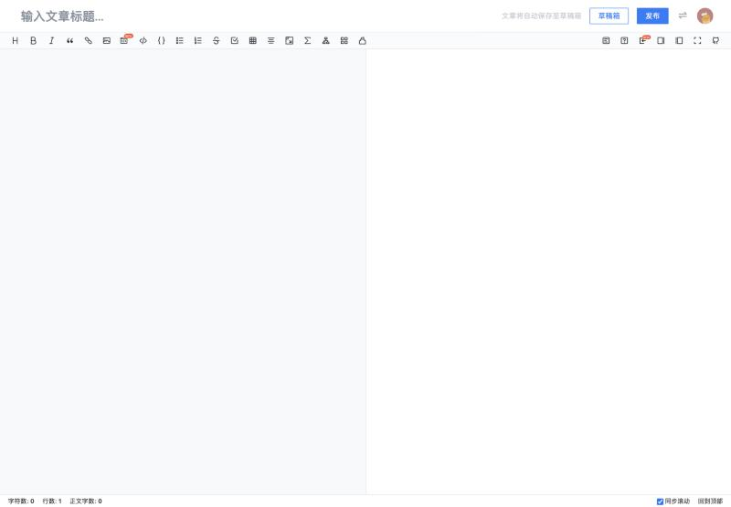
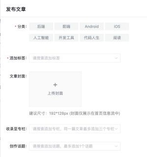
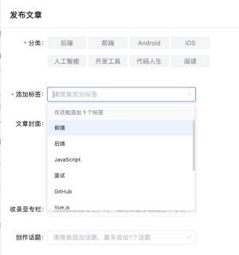
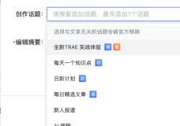

# 掘金（juejin，适配器 `@starnote/publish-juejin`）

调研日期 2026-10-29。资料来自公开资料和开源插件源码。登录后实测的结果记在「实测记录」，还没测的写「待实测」。

## 入口

| 项 | 值 |
|---|---|
| 登录 | `https://juejin.cn/login`（手机验证码 / 密码 / 第三方登录） |
| 写文章 | `https://juejin.cn/editor/drafts/new` |
| 创作者中心 | `https://juejin.cn/creator/home` |
| 登录检测 | `GET https://api.juejin.cn/user_api/v1/user/get` |
| logo | `packages/logos`：`juejin.svg` |

## 官方开放能力

MCP、发布 API、Webhook、OAuth、RSS 导入都**没有**。下面用到的接口全部来自抓包。

## 编辑器与正文格式

- 编辑器是 ByteMD Markdown 编辑器，底层是 CodeMirror。草稿里 `edit_type: 10` 表示 Markdown，正文放在 `mark_content`。
- 图片走字节 ImageX 转存，流程：`gen_token` → `ApplyImageUpload` → PUT 到 TOS → `CommitImageUpload`。站点脚本里用的是 `juejin.cn/image/urlSave` 按 URL 转存，这个接口现在还能不能用，待实测。
- 代码块用 Markdown 原生写法。表格、公式待实测。

## 发布字段

流程：`article_draft/create` → `article_draft/update` → `article/publish`，都在 `api.juejin.cn/content_api/v1/` 下，请求带 `?aid=2608`。

| 字段 | 必填 | 接口字段 | 限制 | 辰记现状 |
|---|---|---|---|---|
| 标题 | 必填 | `title` | 100 字（站点脚本） | ✔ |
| 正文 | 必填 | `mark_content` | | ✔ |
| 分类 | **发布必填** | `category_id`，列表来自 `query_category_briefs` | | 接口里有这个字段，**表单里没有** |
| 标签 | **发布必填** | `tag_ids[]`，搜索用 `query_tag_list` | 数量和创作者等级挂钩：Lv2–3 可选 2 个，Lv4 及以上 3 个（2021 公告，⚠️ 可能已变） | 接口里有这个字段，**表单里没有** |
| 摘要 | **发布必填** | `brief_content` | **50–100 字**，否则接口报错 | ✔（表单只限制了最多 100 字，**没检查至少 50 字**） |
| 封面 | 选填 | `cover_image` | 比例待实测 | 接口里有这个字段 |
| 专栏 | 选填 | 发布时的 `column_ids[]` | | 固定为空 |
| 话题（创作活动） | 选填 | 发布时的 `theme_ids[]` | | 固定为空 |
| 同步到组织 | 选填 | `sync_to_org` | | 固定 false |
| 外链来源 | 选填 | `link_url` | | 固定为空 |
| 定时发布 / 可见范围 / 原创声明 | — | 未查到 | | — |

## 发布规则

- 每日篇数官方没有公布；社区经验是短时间连发会被限流。
- 文章会经过机器审核和人工审核。
- 标签和内容对不上会影响推荐分发（官方 2021 公告）。

## 风控与反爬

- 登录 cookie 是 `sessionid`，有效期约 30 天。
- CSRF：先发 `HEAD https://api.juejin.cn/user_api/v1/sys/token`，请求头带 `x-secsdk-csrf-request: 1`、`x-secsdk-csrf-version`；从响应头 `x-ware-csrf-token` 取逗号后的第二段，之后的请求带上 `x-secsdk-csrf-token`。
- 请求参数 `uuid` 取自 cookie `__tea_cookie_tokens_2608` 里的 `web_id`。不带 `uuid` 会报「请求路由不存在」。
- 签名 `a_bogus` 是否强制：没有证据，Wechatsync 不带也能建草稿。
- 验证码会出现在字节验证中心（`verify.snssdk.com` 等），需要用户自己处理。

## 插件对照

**掘金发布时必填的分类、标签、摘要，所有开源插件都没有自动填。** 这是辰记最容易拉开差距的地方。

| 字段 | Wechatsync | MultiPost | COSE | 辰记现状 |
|---|---|---|---|---|
| 标题 / 正文 / 图片转存 | ✔（ImageX） | ✔ | ✔（Markdown） | ✔ |
| 分类 / 标签 | — | — | — | 接口支持，表单缺 |
| 摘要 | — | — | — | ✔ |
| 封面 / 专栏 / 话题 | — | — | — | 接口支持，表单缺 |
| 发布方式 | 只存草稿 | 可以自动点发布 | 打开编辑页 | 发布台（填好内容，由用户点发布） |

## 辰记要补的

- 表单加三项：
  - **分类**：下拉选择，选项来自接口。
  - **标签**：按关键词搜索后选择，数量上限按账号等级。
  - **封面**。
- 摘要改成 50–100 字校验；留空时用 AI 或截取正文生成一段 50–100 字的摘要。
- 专栏：列出用户自己的专栏供选择。
- 话题（创作活动）：可选。
- 同步到组织：账号有组织时才显示。

## 待实测

- [ ] 标签上限现在按什么规则
- [ ] 封面比例
- [ ] `image/urlSave` 是否还能用
- [ ] 专栏列表接口
- [ ] 话题列表接口
- [ ] 登录检测和限流时返回的 `err_no`

## 实测记录

### 2026-10-29：写文章与发布浮层（新注册账号，桌面宽度 1440）

**编辑器**
- 打开 `juejin.cn/editor/drafts/new` 后，输入第一个字就会建草稿，地址随之变成 `/editor/drafts/{id}`。
- 编辑器仍然是 ByteMD（`.bytemd-editor .CodeMirror`），左边写 Markdown，右边实时预览。
- 标题输入框是 `input.title-input`，**`maxLength` 为 80**。站点脚本里写的 `titleMax: 100` 要改成 80。
- 粘贴富文本时，页面会调用 `POST juejin.cn/markdown/html2md`，在服务端把 HTML 转成 Markdown 再插入编辑器。

**发布浮层**
- 点右上角「发布」只是打开浮层，真正发出去要点浮层里的「确定并发布」。

| 设置 | 必填 | 形式 | 说明 |
|---|---|---|---|
| 分类 | ✔ | 单选，8 个 | 后端、前端、Android、iOS、人工智能、开发工具、代码人生、阅读 |
| 添加标签 | ✔ | 搜索后选择 | **上限和账号等级挂钩，这个新号提示「你还能添加 1 个标签」** |
| 文章封面 | — | 上传 | 建议尺寸 192×128px，只在首页信息流里显示 |
| 收录至专栏 | — | 搜索后选择 | 一篇文章最多收录进 3 个专栏 |
| 创作话题 | — | 搜索后选择，最多 1 个 | 提示「选择与文章无关的话题会被官方移除」 |
| 编辑摘要 | ✔ | 文本框，上限 100 字 | **页面会调用 `article_draft/abstract` 自动生成一份 100 字的摘要并填进来**，用户可以改 |

**页面调用的接口**
- 跨域请求没出现在网络面板里，下面这份是从 `performance` 资源列表读出来的。
- 每个请求都带 `aid` 和 `uuid` 两个参数。

| 用途 | 接口 |
|---|---|
| 当前用户 | `user_api/v1/user/get`、`user/get_info_pack` |
| CSRF | `user_api/v1/sys/token` |
| 分类 | `tag_api/v1/query_category_list`（**站点脚本里写的是 `query_category_briefs`，要核对** 两个接口能否通用） |
| 标签 | `tag_api/v1/query_tag_list` |
| 自己的专栏 | `content_api/v1/column/self_center_list` |
| 话题 | `tag_api/v1/theme/list_by_hot` |
| 建草稿 / 改草稿 | `content_api/v1/article_draft/create`、`/update` |
| 自动摘要 | `content_api/v1/article_draft/abstract?draft_id={id}` |
| 文字纠错 | `content_api/v1/article/text_correction` |

**辰记要改的**
- `titleMax` 从 100 改成 80。
- 表单要补的项：
  - 分类：从 `query_category_list` 取选项。
  - 标签：上限按账号实际剩余数量，从页面提示或接口里读，不能写死 3。
  - 封面：按 192×128（3:2）裁剪。
  - 专栏：从 `self_center_list` 取，最多选 3 个。
  - 话题：从 `theme/list_by_hot` 搜索，最多 1 个。
- 摘要：用户留空时调用 `article_draft/abstract`，取掘金自己生成的摘要；不需要辰记的 AI 来生成。

## 来源

- Wechatsync v2：https://github.com/wechatsync/Wechatsync/blob/v2/packages/core/src/adapters/platforms/juejin.ts
- MultiPost：https://github.com/leaperone/MultiPost-Extension/blob/main/src/sync/article/juejin.ts
- COSE：https://github.com/doocs/cose/blob/main/packages/core/src/platforms/juejin.js
- 第三方接口整理：https://juejin.cn/post/7615506537834807306
- 标签等级公告（2021）：https://juejin.cn/post/6981748496491626532
