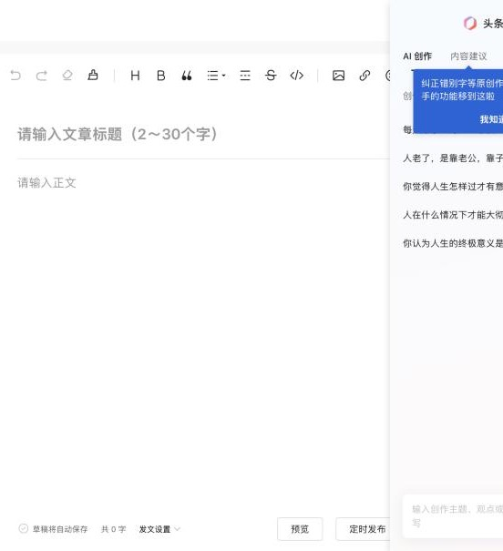
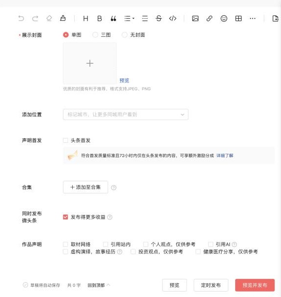

# 头条号（toutiao）

- 调研日期：2026-10-29。
- 来源：
  - 公开资料与开源插件源码，见文末。
  - 登录后实测的部分在「实测记录」一节，还没测的写「待实测」。
- 标记约定：
  - ⚠️ 表示只有第三方说法，或几个来源互相矛盾。
  - 「未查到」表示没有找到来源。

## 入口

| 项 | 值 |
|---|---|
| 登录 | `https://mp.toutiao.com/`，可扫码或用手机号登录（头条 / 抖音账号） |
| 写文章 | `https://mp.toutiao.com/profile_v4/graphic/publish`（旧版 `profile_v3`） |
| 创作者后台 | `https://mp.toutiao.com/profile_v4/index` |
| 登录检测 | `GET https://mp.toutiao.com/mp/agw/media/get_media_info` |
| logo | `packages/logos`：`toutiao-64.png` / `toutiao-128.png` |

## 官方开放能力

| 能力 | 结论 |
|---|---|
| MCP | 未查到 |
| 个人作者可用的发文 API / Token | **没有**。抖音开放平台的发布能力只对应抖音作品，不覆盖头条号文章。文档是单页应用，读不到正文，⚠️ 待确认 |
| Webhook / OAuth / RSS 导入 | 未查到 |

结论：只能走「登录态 + 桌面端发布台」路线。

## 编辑器与正文格式

- **编辑器**：ProseMirror 富文本，接受 HTML。MultiPost 用 `paste` 事件注入 `text/html`；COSE 用 `execCommand('insertHTML')`。
- **图片**：
  - 必须转存。正文里的图片结构是 `

`（code-box）。
  - 新版上传接口：`POST https://mp.toutiao.com/spice/image?upload_source=20020002&aid=1231&device_platform=web`。
  - 旧版上传接口：`/mp/agw/article_material/photo/upload_picture?type=ueditor`；按 URL 转存走 `/tools/catch_picture/`。
- **链接 / iframe**：插件统一删除 `<a>`（保留文字）、`iframe`、SVG 和音乐卡片，说明平台对外链不友好。
- **代码块 / 表格 / 公式 / 视频**：官方说明未查到，待实测。

## 发布字段

发文接口：`POST https://mp.toutiao.com/mp/agw/article/publish?source=mp&type=article&aid=1231`，需要 `msToken` / `a_bogus`，见下文「风控与反爬」。

| 字段 | 必填 | 接口字段 | 说明 |
|---|---|---|---|
| 标题 | 必填 | `title` | 2–30 字，见页面占位符 |
| 正文 | 必填 | `content` | HTML；字数上限未查到 |
| 封面 | 选填 | `pgc_feed_covers`（`url` / `uri` / `thumb_width` / `thumb_height`），`draft_form_data.coverType` | 可选单图、三图或无封面；`coverType` 各取值的含义 ⚠️ 待实测 |
| 摘要 | 选填 | `search_creation_info.abstract` | |
| 投放广告 | 选填 | `article_ad_type` | 旧驱动传 2，code-box 传 3，含义 ⚠️ 待实测；第三方说不打开就没有收益 |
| 头条首发 / 独家 | 选填 | `claim_exclusive`（⚠️ 推断） | 页面上有「头条首发」复选框 |
| 声明原创 | 选填 | 待实测 | 第三方说原创要求正文 300 字以上 |
| 作品声明（个人观点、引用 AI 等） | 选填 | 待实测 | |
| 定时发布 | 选填 | `timer_status` + `timer_time` | |
| 粉丝可见 / 赞赏 | 选填 | `is_fans_article`、`praise`、`disable_praise` | |
| 草稿 / 发布 | — | `save` | code-box 注释说 `save:'0'` 是存草稿，⚠️ 与常理相反，待实测 |

固定参数：`pgc_id:0`、`source:29`、`extra`（含 `content_source`、`content_word_cnt`、`gd_ext`）、`mp_editor_stat:'{}'`、`is_refute_rumor`、`activity_tag`、`trends_writing_tag`。

## 发布规则

- **每日篇数**：官方未查到。第三方转述 2021 年规则：⚠️
  - 文章、问答每天 5 篇；微头条每天 10 条；超出部分只推荐给粉丝。
  - 各体裁合计超过 50 篇后，当天不能再发。
- **新手期**：第三方说 2018 年起已取消。⚠️
- **审核、外链、违规后果**：未查到官方原文。插件都会删外链，辰记默认也要删，或者把链接改成纯文字。

## 风控与反爬

- **登录态**：
  - 网页会话 cookie 常见的有 `sessionid`、`ttwid`、`msToken`，⚠️ 待实测。
- **CSRF**：
  1. 请求 `HEAD https://mp.toutiao.com/ttwid/check/`，带上 `x-secsdk-csrf-request:1` 和 `x-secsdk-csrf-version:1.2.22`。
  2. 从响应头 `x-ware-csrf-token` 取出令牌，放进请求头 `x-secsdk-csrf-token`。
  3. 另外还有 `GET /tt-anti-token`。
- **签名**：发文接口要带 `a_bogus` / `msToken`。这两个值由页面里的 JS 在请求时自动注入，在页面外自己发的请求不会带上。
  - 插件的做法：在页面主世界里调用 `fetch`。
  - 辰记桌面端的对应做法：在平台页面内执行请求（`webContents` 主世界），不能用 `session.fetch` 直接发。
  - **不实现、也不复刻签名算法。**
- **验证码 / 频率限制**：触发条件未查到。出现字节的验证中心页面（`verify.snssdk.com` 等）时，交给用户自己处理。

## 插件对照

| 字段 | Wechatsync | MultiPost | COSE | code-box | 辰记现状 |
|---|---|---|---|---|---|
| 标题 | ✔ | ✔（≤30） | ✔ | ✔ | 没有适配器 |
| 正文 HTML + 图片转存 | ✔ | ✔ | 只按行拆成纯文本 | ✔ | — |
| 封面 | ✔（旧驱动） | ✔（走页面上传） | — | 关闭 | — |
| 摘要 | — | — | — | ✔ | — |
| 广告 / 首发 / 定时 | 固定值 | — | — | 字段在，值固定 | — |
| 发布方式 | 草稿 | 可自动点发布 | 填表 | 草稿 | — |

## 辰记要做到的

不能比插件差，以下都要能填：
- 标题，自动截到 30 字。
- 正文：HTML 转成头条图片结构，图片转存，外链改成纯文字。
- 封面：单图 / 三图 / 无封面。
- 摘要。
- 投放广告、头条首发、声明原创、作品声明（含「引用 AI」）、定时发布。

这些都放进表单。默认走发布台：填好内容，由用户自己点「发布」。

## 待实测

- [ ] `coverType` 的取值。
- [ ] `article_ad_type` 和 `claim_exclusive` 的含义。
- [ ] `save` 的语义。
- [ ] 作品声明、原创声明对应的接口字段。
- [ ] 登录用的 cookie 名。
- [ ] 正文对代码块、表格的支持。
- [ ] 每日篇数限制在页面上怎么提示。

## 实测记录

### 2026-10-29：新号（手机号注册，8 个粉丝，没发过作品）

**账号门槛**
- 主页提示「请完善账号信息，解锁发布文章、视频等权益功能」。新号要先补全资料（名称、头像、简介等），才能正常发文。
- 辰记在绑定头条号时要检查这一项，没补全就提示用户去补。

**编辑器**（`/profile_v4/graphic/publish`）
- 正文是 ProseMirror（`.ProseMirror[contenteditable]`）。
- 标题是 `textarea`，占位文字「请输入文章标题（2～30个字）」，没有设 `maxLength`。字数不够时，页面会提示「还需输入 N 个字」。
- 工具栏：撤销、重做、清除格式、格式刷、标题、加粗、引用、列表、分割线、删除线、代码、图片、链接、表情、**表格**、更多。
- 右侧有「头条创作助手」，提供 AI 创作和内容建议（检测错别字等）。
- 底部：自动保存草稿、字数统计、「发文设置」，以及三个按钮：**预览**、**定时发布**、**预览并发布**。

**发布设置**（在正文下方，没有弹窗）

| 字段 | 必填 | 形式 / 取值 |
|---|---|---|
| 展示封面 | ✔ | 单图（默认）/ 三图 / 无封面。支持 JPEG、PNG，可以预览 |
| 添加位置 | — | 选择城市，提示「标记城市，让更多同城用户看到」 |
| 声明首发 | — | 「头条首发」：符合首发质量标准、且 72 小时内只在头条发布的内容，可以拿额外激励分成，单篇有补贴。**和多平台同发冲突**：勾了首发就不能在 72 小时内发到别的平台 |
| 合集 | — | 「添加至合集」，列表来自 `/mp/fe_api/collection/list` |
| 同时发布微头条 | — | **默认勾选**，提示「发布得更多收益」 |
| 作品声明 | — | 多选：取材网络 / 引用站内 / 个人观点，仅供参考 / **引用AI** / 虚构演绎，故事经历 / 投资观点，仅供参考 / 健康医疗分享，仅供参考 |
| 投放广告 | — | 新号的表单里**没有**这一项。收益设置页说明「手动发表内容的广告投放类型以发表作品时的设置为准」，所以开通创作收益以后，发文表单里才会出现 |

**页面调用的接口**（都在 `mp.toutiao.com` 下）

| 用途 | 接口 |
|---|---|
| 新建文章模板 | `/mp/agw/article/new?article_type=&format=&compat=&column_no=` |
| 剩余可发篇数 | `/mp/agw/article/fan_article_count_remained` |
| 发文压制提示 | `/mp/agw/general/creator_helper/publish_suppression_tip?genre_list=` |
| 合集列表 | `/mp/fe_api/collection/list` |
| 用户与权限 | `/mp/agw/media/get_user_base_info`、`check_user_auth`、`user_login_status_api` |
| CSRF | `/ttwid/check/` |

**风控实测**
- 页面加载了字节系的四套安全组件：`bdms`、`secsdk`、`byted_acrawler`、`_SdkGlueInit`。
- 能读到的 cookie 有 `passport_csrf_token`、`csrf_session_id`、`x-web-secsdk-uid`、`s_v_web_id`、`ttcid`、`odin_tt`、`tt_scid`。登录态 cookie `sessionid` 等是 httpOnly，页面读不到。
- 上面这些 GET 接口的 URL 里都没带 `a_bogus` / `msToken`。发布接口带不带，要等真正发布时才能确认。
- 结论：**辰记只在头条页面内操作**，填好表单后由用户点「预览并发布」，签名交给页面自己加。

**发布后的数据**（`/profile_v4/analysis/works-overall/all`，**每天 14:00 前更新前一天的数据**）

| 内容 | 接口 |
|---|---|
| 核心数据：展现、阅读（播放）、粉丝展现 / 阅读、点赞、评论 | `/mp/agw/statistic/v2/content_stat?type=` |
| 趋势 | `/mp/agw/statistic/v2/content/stat_trends?from=&to=&type=` |
| 读者画像：性别、年龄、地域、机型价格 | `/mp/agw/statistic/v2/content/user_property` |
| 最新数据日期 | `/mp/agw/statistic/v2/helper/latest_ready_date` |
| 单篇数据 | 「单篇」页签，接口待实测；页面可以下载 Excel |

辰记的做法：头条适配器实现 `fetchStats`，每天在页面内读一次即可。

**变现**

- **收益数据页**（`/profile_v4/analysis/income-overview`）
  - 显示昨日、本月、累计收益，可提现金额，以及收益趋势。
  - 图文和视频的创作收益合并显示。
  - 接口：`/mp/agw/income/overview/income/details`、`/pgc/mp/income/income_statement_abstract`、`/pgc/mp/income/module_permission_describe`。
- **收益设置**
  - 只有一个「广告投放」选项，默认「不投放广告」。
  - 这个设置只对自动同步的内容生效，手动发表的作品以发表时的设置为准。
- **创作权益**（`/profile_v4/personal/creator-growth`）
  - 「发布 1 篇作品，解锁作者等级」。
  - 等级权益：微头条 / 文章 / 视频 / 小视频创作收益、图文赞赏、视频赞赏、头条抽奖、身份标识、分成补贴、加油包奖励、荣誉榜单、专属活动、精选作者提报、VIP 客服。
  - 具体门槛见页面上的「详情规则」。
  - ⚠️ 公开资料说，开通创作收益要实名、粉丝 ≥ 100，待核对。
- **首发激励**：勾选「头条首发」，内容符合质量标准、且 72 小时内只在头条发，就有单篇补贴。
- **创作活动**：主页推荐有奖活动（瓜分奖金、话题 PK 等），按活动要求带话题投稿即可。

**对辰记的影响**
- 「头条首发」和多平台同发有冲突。辰记在多平台发布时，默认**不勾**头条首发，并说明原因。如果用户想要首发补贴，就把头条排在最前面，其他平台延后 72 小时再发。
- 「同时发布微头条」默认是勾上的。辰记沿用这个默认值，但要让用户看得到、能取消。
- 「投放广告」只对开通了创作收益的账号显示。
- 作品声明里的「引用AI」：内容用了辰记的 AI 写作时，建议默认勾上。

## 来源

- Wechatsync：
  - 旧驱动：https://github.com/wechatsync/Wechatsync/blob/old/packages/@wechatsync/drivers/src/toutiao.js
  - v2 content script：https://github.com/wechatsync/Wechatsync/blob/v2/packages/extension/src/content/toutiao.ts
  - v2 适配器在私有子模块里，读不到。
- code-box：https://github.com/027xiguapi/code-box/blob/main/sync/adapters/platforms/toutiao.ts
- MultiPost：https://github.com/leaperone/MultiPost-Extension/blob/main/src/sync/article/toutiao.ts
- COSE：https://github.com/doocs/cose/blob/main/packages/core/src/platforms/toutiao.js
- 易媒助手帮助中心：https://www.yimeizhushou.com/help.html
