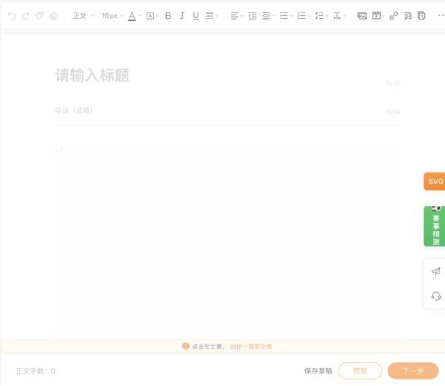
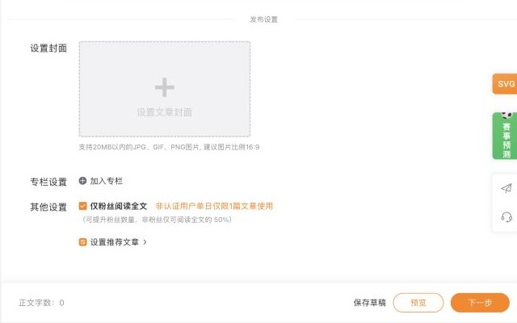

# 微博（weibo）：短微博与头条文章

调研日期 2026-10-29。资料来自公开资料和开源插件源码。登录后实测的结果记在「实测记录」，还没测的写「待实测」。

## 入口

| 项 | 值 |
|---|---|
| 登录 | `https://passport.weibo.com/sso/signin`（扫码 / 短信） |
| 头条文章编辑器 | `https://card.weibo.com/article/v5/editor`（也有 v3） |
| 发短微博 | `https://weibo.com/` 首页的发布框 |
| logo | `packages/logos`：`weibo.svg` |
| 辰记现状 | 走 `@starnote/publish-share`，打开微博的分享页，带上摘要和原文链接，不需要绑定 |

## 官方开放能力

| 能力 | 结论 |
|---|---|
| MCP | 未查到 |
| 官方 API | 只有 `statuses/share`：`POST https://api.weibo.com/2/statuses/share.json`，用 OAuth2 的 `access_token`，还要传真实 IP `rip` |
| 头条文章 API | 未查到官方接口 |
| Webhook / RSS 导入 | 未查到 |

`statuses/share` 的限制：

- 正文最多 140 个汉字。
- 正文里必须带一个属于应用「安全域名」的网址。
- 正文不能含 `#话题#`。
- 配图可选，小于 5MB。
- 有调用频率限制。

对辰记来说，`statuses/share` 适合用来发一条「带原文链接的短微博」。申请这个接口需要辰记自己注册微博应用，并配置安全域名（例如 starnote.app）。

## 编辑器与正文格式（头条文章）

- 编辑器是 ProseMirror / TipTap，接受 HTML。
- 图片：
  - 正文图片的结构是 `<figure class="image"></figure>`。
  - 上传方式一：调 `asyncuploadimg` 让服务端去抓外链图，再轮询 `asyncimginfo` 看结果（`task_status_code` 为 1 是成功，2 是失败）。
  - 上传方式二：直接把图片传到 `picupload.weibo.com/interface/pic_upload.php`。
- 代码块、表格、公式：待实测。

## 发布字段（头条文章）

接口流程：先调 `POST https://card.weibo.com/article/v5/aj/editor/draft/create`，再调 `.../draft/save`。两次都带 `uid` 和 `_rid`。

| 字段 | 必填 | 接口字段 | 说明 |
|---|---|---|---|
| 标题 | 必填 | `title` | MultiPost 截到 32 字 |
| 正文 | 必填 | `content` | HTML |
| 封面 | 选填 | `cover` | 先传到图床。MultiPost 会裁成 16:9；第三方说尺寸是 980×560 ⚠️ |
| 导语 | 选填 | `summary` | MultiPost 截到 44 字 |
| 副标题 / 作者 | 选填 | `subtitle` / `writer` | |
| 定时发布 | 选填 | `publish_at` / `publish_local_at` / `timestamp` | |
| 关注后阅读 | 选填 | `follow_to_read`、`follow_to_read_detail` | 未认证用户每天只能有 1 篇文章使用 |
| 赞赏 | 选填 | `isreward` | |
| 付费阅读 | 选填 | `pay_setting`、`is_article_free`、`free_content`、`money` | |
| AI 声明 | 选填 | `is_aigc_used`、`is_ai_plugins` | |
| 文集 | 选填 | `collection` | |
| 文末推荐 | 选填 | `article_recommend` | |
| 草稿 / 发布 | — | `status`、`save`、`action` | Wechatsync 存草稿时传 `status:0`、`save:1`、`action:1` |

短微博：正文 + 图片 + `#话题#`。可见范围、评论设置：待实测。

## 发布规则

- 官方的发文规则（每日条数、引流、违规）：未查到。
- 已知只有一条：未认证用户每天只能有 1 篇文章开启「关注后阅读」。

## 风控与反爬

- 登录 cookie：`SUB`、`SUBP`。
- 写操作要带请求头 `X-XSRF-TOKEN`，值取 cookie `XSRF-TOKEN`，**先做 URL 解码**，否则返回 403。
- 头条文章接口还要带：
  - `SN-REQID`：43 位随机串（参考 Wechatsync 的 `generateReqId`）。
  - `Origin` / `Referer`：设为编辑器页面地址。
- 频率：第三方客户端把写请求串行，每次间隔 800ms，遇到 429 就暂停一段时间 ⚠️。
- 第一次访问会经过「Sina Visitor System」访客验证。它会自动跳转，跳不过去就让用户刷新，或在自己的浏览器里完成。

## 插件对照

| 字段 | Wechatsync | MultiPost | COSE | 辰记现状 |
|---|---|---|---|---|
| 标题 / 正文 / 图片转存 | ✔ | ✔ | 标题、正文 | 只有分享页（摘要 + 链接） |
| 封面 | ✔ | ✔（16:9） | — | — |
| 导语 | — | ✔ | — | — |
| AI 声明 / 关注后阅读 / 赞赏 | 固定值 | 固定值 | — | — |
| 发布方式 | 草稿 | 草稿（v5 失败时退回 v3） | 点「保存草稿」 | 打开分享页 |

## 辰记要做到的

- 新增「头条文章」桌面端发布台。表单要能填：
  - 标题、正文（图片转存）、封面（16:9 裁剪）、导语
  - 定时发布、关注后阅读、赞赏、AI 声明、文集
- 短微博继续走分享页。以后如果申请到微博应用，再加 `statuses/share` 一键发「链接 + 摘要」。

## 待实测

- [ ] v5 编辑器是否仍是默认
- [ ] 封面的官方尺寸
- [ ] 正文是否支持代码块、表格
- [ ] 可见范围、评论设置对应哪个字段
- [ ] `status`、`save`、`action` 的取值含义

## 实测记录

### 2026-10-29：头条文章编辑器（新号，没认证）

**编辑器**（`card.weibo.com/article/v5/editor`）
- 编辑器是 tiptap / ProseMirror（`.tiptap.ProseMirror.wb-editor`）。
- 左边是草稿箱，**最多存 30 篇**；另有「发布历史」。要先点「写文章」，编辑区才能用。点了就会调用 `draft/create`，生成一篇「未命名」草稿，地址变成 `#/draft/{id}`。
- 标题是 `textarea`，**最多 32 字**。下面是「导语（选填）」，**最多 44 字**。
- 工具栏：正文 / 标题、字号、文字颜色、背景色、加粗、斜体、下划线、删除线、对齐、缩进、行距、列表、图片、视频、链接，以及更多。
- 底部按钮：保存草稿、预览、**下一步**。「下一步」之后才是最终发布，还没看到下一步里有什么。

**发布设置**（在正文下方）

| 字段 | 默认 | 说明 |
|---|---|---|
| 设置封面 | — | 20MB 以内的 JPG、GIF、PNG，建议 16:9 |
| 专栏设置 | — | 加入专栏 |
| 仅粉丝阅读全文（`follow_to_read`） | **勾选** | 非粉丝只能读到 50%，可以帮助涨粉。**没认证的用户每天只有 1 篇能用这个功能** |
| 设置推荐文章（`article_recommend`） | — | 在文末推荐其他文章 |

**草稿字段**（来自 `draft/load` 的返回；新建草稿时的默认值）
- 文章本体：`title`、`summary`（导语）、`content`、`cover`、`writer`、`free_content`
- 定时发布：`publish_at` / `publish_local_at` / `timestamp`
- `is_markdown`：⚠️ 可能可以直接用 Markdown 导入，待实测
- AI 声明：`is_aigc_used`、`is_ai_plugins`
- 关注后阅读：`follow_to_read: 1`，`follow_to_read_detail.daily_limit: 1`
- 赞赏：`isreward: 0`，另有赞赏申请说明的链接
- 付费阅读：`pay_setting`、`is_article_free`、`money`、`is_single_pay_new`、`is_vclub_single_pay`
- 其他：`article_recommend`、`status`、`action`

**页面调用的接口**
- 都在 `card.weibo.com/article/v5/aj/editor/` 下：`draft/list?uid=&allow_pay=&_rid=`、`draft/create`、`draft/load`。另外 `aj/face` 是表情。
- 能读到的 cookie 只有 `SUBP`、`ALF` 等几个，`SUB` 是 httpOnly，页面脚本读不到。

**发布后的数据和变现**（创作者中心 `me.weibo.com`）
- 菜单：
  - 数据中心：数据总览、博文数据、视频数据、粉丝数据、主页数据
  - 广告中心：跳到 `tui.weibo.com`
  - **收益中心**：收益总览、**广告共享计划**、**创作激励**、**微博赞赏**
- 首页显示近 7 日阅读、互动、涨粉，以及昨日收益、全年收益。
- 首页用到的接口：`me.weibo.com/api/proxy/native/dataview`、`dataprofit`、`creatorinspire`、`menu`。
- 各项收益的开通条件还没看。⚠️ 广告共享计划和赞赏一般要求认证或达到一定粉丝数，待查。

**对辰记的影响**
- 用户没认证时，「仅粉丝阅读全文」每天只能用 1 篇。辰记沿用默认勾选，但要提示这个限制。
- 标题按 32 字截断，导语按 44 字截断；封面裁成 16:9。
- 发布流程分两步：编辑页点「下一步」后，再在下一步页面点发布。辰记把编辑页填好后，交给用户自己点「下一步」和发布。

## 来源

- `statuses/share`：https://open.weibo.com/wiki/2/statuses/share
- Wechatsync v2：https://github.com/wechatsync/Wechatsync/blob/v2/packages/core/src/adapters/platforms/weibo.ts
- MultiPost：https://github.com/leaperone/MultiPost-Extension/blob/main/src/sync/article/weibo.ts
- COSE：https://github.com/doocs/cose
- Matter（第三方客户端）的鉴权说明：https://github.com/HapeLee/Matter/blob/main/docs/credential-auth-review.md
