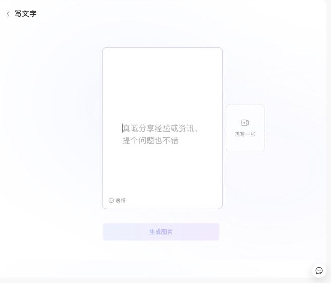
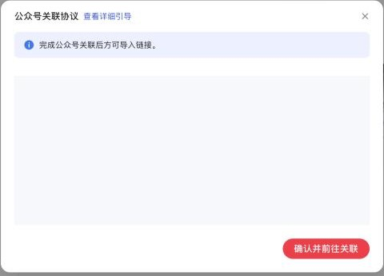
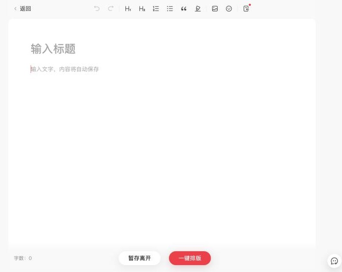
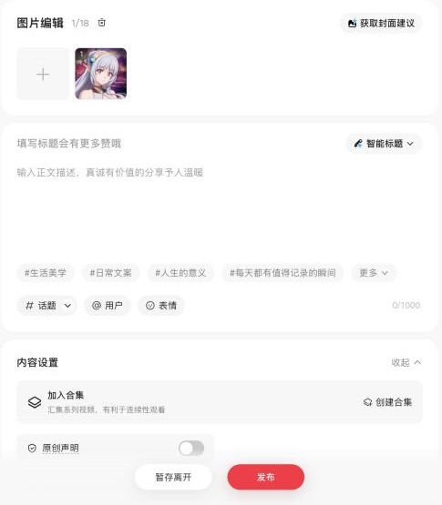
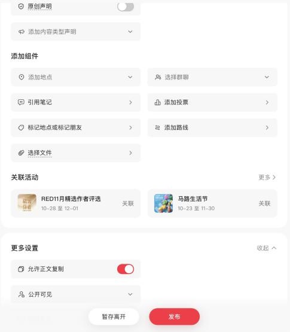
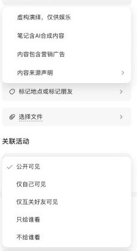

# 小红书（xiaohongshu）

调研日期：2026-10-29。资料来自公开资料和开源工具源码。登录后实测的结果记在「实测记录」，还没测的写「待实测」。

## 入口

| 项 | 值 |
|---|---|
| 登录 | `https://creator.xiaohongshu.com/`（扫码或手机验证码；可以用手机 App 里的账号） |
| 上传图文 | 创作服务平台 →「发布笔记」→「上传图文」 |
| 写长文 | `https://creator.xiaohongshu.com/publish/publish?from=menu&target=article` |
| logo | `packages/logos`：`xiaohongshu.svg` |

## 官方开放能力

| 能力 | 结论 |
|---|---|
| MCP | 没有官方的。`xpzouying/xiaohongshu-mcp` 是第三方实现，用无头浏览器操作网页 |
| 个人作者发布 API | **没有**。开放平台主要面向品牌方和广告主，要求企业认证 ⚠️ |
| Webhook / RSS 导入 | 未查到 |

## 编辑器与正文格式

- **图文笔记**：图片加一段短正文。正文框是 `div[role="textbox"][contenteditable]`（tiptap）。
- **长文笔记**：ProseMirror 编辑器，最多 10000 字。Wechatsync 往里写的是 ProseMirror JSON。
- **正文格式**：不接受 Markdown，只能用 HTML 或 ProseMirror JSON。
- **图片上传**：必须传到小红书。流程是先 `GET /api/media/v1/upload/web/permit` 取 `file_id` 和 `token`，再 `PUT ros-upload.xiaohongshu.com/{file_id}`。
- **代码块、表格、公式**：待实测。小红书本来就不适合这类内容，辰记做转换时应该把它们改成图片或纯文字。

## 发布字段（图文笔记）

| 字段 | 必填 | 说明 |
|---|---|---|
| 标题 | 必填 | **20 字**（页面会实时提示）。长文标题 64 字 ⚠️ |
| 正文 | 必填 | **1000 字**。长文 10000 字 |
| 图片 | 至少 1 张 | 最多 18 张 ⚠️。第一张就是封面 |
| 话题 | 选填 | **最多 10 个**。输入 `#话题名` 后，从联想列表里点选 |
| @用户 | 选填 | 内部字段 `ats` |
| 定时发布 | 选填 | 只能定在 **1 小时到 14 天之内** |
| 可见范围 | 选填 | 公开（默认）/ 仅自己可见 / 仅互关好友可见 |
| 原创声明 | 选填 | 打开开关后，要勾选「原创声明须知」再点「声明原创」 |
| 商品 | 选填 | 账号要先开通商品功能 |
| 地点 | 选填 | 内部字段 `post_loc`，怎么选地点待实测 |
| 内容类型声明 / 评论设置 / 合集 | — | 待实测 |

内部发布接口 `POST edith.xiaohongshu.com/web_api/sns/v2/note` 需要 `x-s` 签名，**辰记不调用这个接口**（理由见下文）。

## 发布规则

- **每日篇数**：官方没有公布。有人凭经验说一天 50 篇左右 ⚠️。发得太频繁会触发 `RATE_LIMIT`。
- **审核**：发布后先是「审核中」。
- **导流**：带网址、联系方式、二维码、售卖话术的笔记不会被推荐。导流违规会按次数升级处罚：先警告，再限流加禁言 ⚠️。
- **重点监测**：虚构体验、夸大其词、搬运、诱导、导流、拉踩。
- **限流**：一般不会通知。

## 风控与反爬

这是风控最严的一家。

- **cookie**：`a1` 用于签名，`web_session` 是登录态。
- **请求签名**：`x-s`、`x-t`、`x-s-common`，算法没有公开。**辰记不复刻签名，也不在页面外调这些接口。**
- **验证与封禁**：
  - 返回 461 / 471 时，响应头会带 `Verifytype`，需要用户自己完成验证。
  - 还会按 IP 限流。
- **单端登录**：同一账号不能同时在多个网页端登录，另一端登录会把这边踢下线。所以桌面端发布台会和用户自己浏览器里的登录互相顶掉，界面上要提示这一点。

## 插件对照

| 字段 | Wechatsync | MultiPost | COSE | xiaohongshu-mcp | 辰记现状 |
|---|---|---|---|---|---|
| 标题 / 正文 | 长文（私有适配器） | ✔ | ✔（长文） | ✔ | 没有适配器 |
| 图片 | ✔ | ✔ | — | ✔ | — |
| 话题 | — | 把 `#tag#` 当文字加在正文末尾 | — | ✔（从联想列表点选） | — |
| 定时发布 / 可见范围 / 原创 / 商品 | — | — | — | ✔ | — |
| 发布方式 | 存草稿 | 可以自动点发布 | 存草稿 | 可以发布 | — |

## 辰记要做到的

**只用页面操作（DOM）的发布台。** 辰记不调签名接口，用户登录后，由辰记在页面里把这些都填好：

- 图片：笔记里的图片，或用辰记卡片版式生成的图片，最多 18 张。
- 标题：20 字以内，超出要提示。
- 正文：1000 字以内。
- 话题：从联想列表点选，不是把 `#话题#` 当文字写进正文。
- 定时发布、可见范围、原创声明、地点。

最后由用户自己点「发布」。

长文笔记另外做一个入口。

## 待实测

- [ ] 图片张数上限
- [ ] 长文的标题和正文字数上限
- [ ] 地点怎么选
- [ ] 评论设置、内容类型声明
- [ ] 桌面端登录会不会把用户浏览器里的登录踢下线

## 实测记录

### 2026-10-29：创作服务平台（新号，0 粉丝）

整个过程控制了访问频率：每个页面只打开一次，停留几秒，只读页面，没有调用任何接口。

**发布入口**（`/publish/publish?target=image|article`）
- 四个页签：上传视频、上传图文、写长文、发播客。右上角是「草稿箱」。

**上传图文**
- 先上传图片，后面的表单才会出现。图片要求：
  - 单张最大 32MB；
  - 推荐 png / jpg / jpeg / webp，**不支持 gif、live 图及其转出来的图片**；
  - 不限宽高比，推荐 3:4 到 2:1，分辨率不低于 720×960。超过 1280P 的图片用网页端上传更清晰。
- 还有一个「**文字配图**」：用户写文字，可以「再写一张」写成多张，点「生成图片」后平台把文字做成卡片图。
- 辰记可以用自己的卡片版式生成图片，也可以直接用这个功能。

**写长文**
- 入口页有「新的创作」「导入链接」「新建长文合集」。
- 「**导入链接」要先关联公众号**，弹出的是「公众号关联协议」，提示「完成公众号关联后方可导入链接」。所以它只能导入公众号文章，不能导入任意网页。
  - 可以走的路线：先发公众号，再把公众号文章链接导进小红书长文。
- 编辑器是 tiptap / ProseMirror。
  - 标题是 `textarea`，`maxLength` 为 **64**。
  - 正文的占位文字是「输入文字，内容将自动保存」。
- 工具栏：撤销、重做、H1、H2、有序列表、无序列表、引用、高亮、图片、表情，以及一个导入按钮。
- 底部两个按钮：「暂存离开」「**一键排版**」。点一键排版后选版式，再进入发布设置。必须先写内容才能往下走，这一步还没看。

**图文笔记的发布表单**（用户先上传了 1 张图，地址是 `/publish/publish?target=image`）

| 区域 | 字段 | 说明 |
|---|---|---|
| 图片编辑 | 图片 | **最多 18 张**（页面显示「1/18」），可以编辑、调整顺序；有「获取封面建议」按钮，第一张就是封面 |
| 标题 | `input` | 占位文字「填写标题会有更多赞哦」；有「智能标题」按钮。没有设置 `maxLength`，上限 20 字是第三方的说法，待确认 |
| 正文 | tiptap（`.tiptap.ProseMirror`） | 占位文字「输入正文描述，真诚有价值的分享予人温暖」，**最多 1000 字**；下面有一排推荐话题，可以加「# 话题」「@ 用户」「表情」 |
| 内容设置 | 加入合集 | 也可以新建合集 |
| | 原创声明 | 开关，默认关 |
| | 添加内容类型声明 | 下拉选项：虚构演绎，仅供娱乐 / **笔记含AI合成内容** / 内容包含营销广告 / 内容来源声明（还有下一级菜单） |
| 添加组件 | | 添加地点、选择群聊、引用笔记、添加投票、标记地点或标记朋友、添加路线、选择文件 |
| 关联活动 | | 官方活动，比如「RED11月精选作者评选」「马路生活节」，可以点「更多」看全部 |
| 更多设置 | 允许正文复制 | 开关，**默认开** |
| | 可见范围 | 公开可见（默认）/ 仅自己可见 / 仅互关好友可见 / 只给谁看 / 不给谁看 |
| | **定时发布** | 开关 |

- 底部按钮：「暂存离开」「发布」。
- 右侧可以切换「笔记预览」和「封面预览」。

**辰记填表的顺序**
1. 往 `input[type=file]` 里放图片，最多 18 张。
2. 填标题和正文。
3. 话题：在正文里输入 `#`，从联想列表里点选。
4. 合集。
5. 原创声明。
6. 内容类型声明：内容用了辰记 AI 时，建议选「笔记含AI合成内容」。
7. 地点。
8. 可见范围。
9. 定时发布。

最后由用户自己点「发布」。现在的开源插件里，只有 xiaohongshu-mcp 能把这些都填上，辰记至少要做到和它一样。

**风控实测**
- 页面里能看到签名相关的全局变量：`_webmsxyw`（生成 x-s 签名）、`mnsv2`、`xsecappid`、`xsecplatform`、`xsecappvers`，指纹 `xhsFingerprintV3`。
- 能读到的 cookie：`a1`、`webId`、`gid`、`websectiga`、`sec_poison_id`、`xsecappid`、`loadts`、`webBuild`。登录态 `web_session` 是 httpOnly，读不到。
- 创作服务平台的接口在 `creator.xiaohongshu.com/api/galaxy/...`，主站接口在 `edith.xiaohongshu.com`。
- 结论：**辰记只在页面里填表单，不调用这些接口**：
  - 上传图片走页面上的 `input[type=file]`；
  - 话题从页面的联想列表里点选；
  - 最后的「发布」由用户点。
- 小红书一个账号只能在一个网页端登录，桌面端发布台登录后，可能把用户自己浏览器里的登录踢掉。绑定时要提醒用户。

**发布后的数据**（首页「笔记数据总览」，统计周期按自然周）

| 指标 | 接口 |
|---|---|
| 曝光、观看、封面点击率、视频完播率、点赞、评论、收藏、分享、净涨粉、新增关注、取消关注、主页访客 | `api/galaxy/v2/creator/datacenter/account/base` |
| 最近笔记数据 | `api/galaxy/creator/home/latest_note_data` |
| 直播数据 | `api/galaxy/v2/creator/datacenter/livedata/overview` |

单篇笔记的数据在「数据看板 / 笔记管理」，接口待实测。这些接口都要签名，**只能在页面里读**，比如打开数据看板后读页面上显示的内容，或者读页面自己发出请求的返回结果。不要在页面外直接调接口。

**变现与成长权益**（`api/galaxy/v2/creator/rightscenter/growthrights/batchquery`，按粉丝段 1、2、3…9 分级发放）

| 权益 | 从哪一级起有 | 说明 |
|---|---|---|
| 买手合作 | 第 1 级（起步就有） | 在买手合作平台选商品，做直播带货、笔记带货，拿服务费 |
| 作者任务 | 1 | 完成任务能更快拿到官方权益，还有创作激励 |
| 笔记催审、账号检测、笔记置顶（最多 2 篇）、创建合集 | 1 | |
| **定时发布** | 1 | 「获得定时发布权限后」才能设置发布时间，新号从第 1 级起就有 |
| 薯条加热 | 1 | 花钱给笔记推流的工具。每升一个粉丝段送一包优惠券，包含 75 元无门槛券 |
| **博主合作（蒲公英）** | 第 3 级 | 接品牌商单拿收入 |
| 原创保护 | 第 9 级 | 防仿冒、防搬运、矩阵保护 |

- 首页显示「粉丝 0/500」，说明下一个粉丝段是 500 粉。
- 各级对应的具体粉丝数还没看到，⚠️ 公开资料说蒲公英需要 1000 粉。

**建议：图文和长文拆成两个发布对象**（2026-10-29，陆德俊提出）

两种笔记从发布入口开始就是两套流程，平台注册表里应该登记成两个 key，共用同一个登录态：

| | `xiaohongshu`（图文笔记） | `xiaohongshu-article`（长文笔记） |
|---|---|---|
| 内容类型 | `image-set`（另有视频，后续再说） | `article` |
| 入口 | `target=image` | `target=article` →「新的创作」 |
| 正文 | 图片 1–18 张 + 正文最多 1000 字 | 长文编辑器（tiptap），标题最多 64 字 |
| 辰记渲染 | 笔记转成卡片图（3:4），再从正文提炼出最多 1000 字 | 笔记按长文排版，图片转存到小红书 |
| 发布前一步 | 直接填表单 | 「一键排版」选版式，然后进入发布设置 |
| 适合的内容 | 生活、种草、要点卡片 | 教程、深度文章 |
| 表单字段 | 见上方「图文笔记的发布表单」 | 待实测：排版完成后的发布设置 |

- 现在注册表里只有一个 `xiaohongshu`，`contentTypes` 是 `['image-set', 'video']`，长文没有地方放。
- 拆开以后，用户可以同一篇笔记两种都发，「我的传播」里也能分开统计数据。
- 绑定时只需要登录一次：两个 key 共用同一个账号（`AccountRef`）和同一个 cookie 会话。
- 微博也是同样的情况：短微博和头条文章是两套编辑器，可以照这个思路拆成 `weibo` 和 `weibo-article`。

**对辰记的影响**
- 小红书走「图文笔记」：图片用辰记的卡片版式生成（3:4），正文不超过 1000 字，话题从联想列表点选。
- 长文笔记可以作为第二条路线，走一键排版。
- 要是已经发了公众号，可以提示用户「在小红书长文里导入公众号链接」，前提是用户已经把公众号关联到小红书。
- 定时发布、合集都是第 1 级权益，可以默认显示。
- 「博主合作」到第 3 级才开。辰记可以在绑定页显示离下一个粉丝段还差多少，比如「粉丝 0/500」。

## 来源

- xiaohongshu-mcp：https://github.com/xpzouying/xiaohongshu-mcp（`xiaohongshu/publish.go`）
- ReaJason/xhs：https://github.com/ReaJason/xhs（`xhs/core.py`）
- xiaohongshu-cli：https://pkg.go.dev/github.com/tamnd/xiaohongshu-cli
- Wechatsync CHANGELOG：https://github.com/wechatsync/Wechatsync/blob/v2/CHANGELOG.md
- MultiPost：https://github.com/leaperone/MultiPost-Extension/blob/main/src/sync/dynamic/rednote.ts
- COSE：https://github.com/doocs/cose/blob/main/packages/core/src/platforms/xiaohongshu.js
