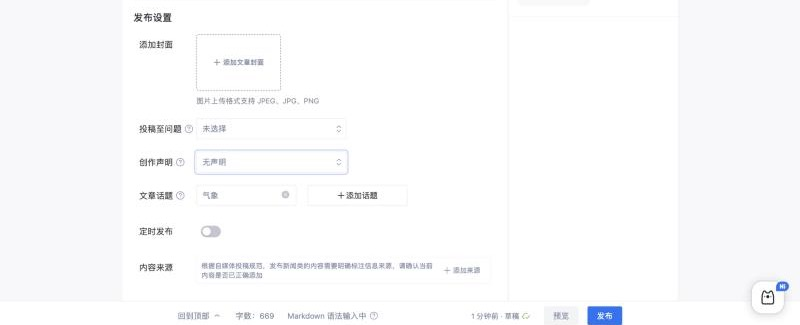
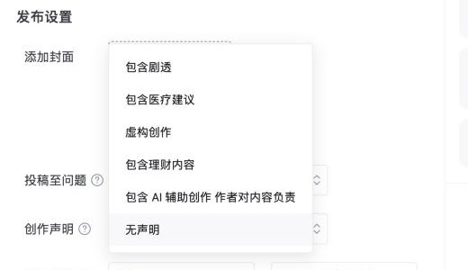

# 知乎专栏（zhihu，适配器 `@starnote/publish-zhihu`）

调研日期：2026-10-29。资料来自公开资料和开源插件源码。登录后实测的结果记在「实测记录」，没测到的标「待实测」。

## 入口

| 项 | 值 |
|---|---|
| 登录 | `https://www.zhihu.com/signin?next=%2Fcreator`：扫码 / 手机验证码 / 密码；手机号第一次登录会自动注册 |
| 写文章 | `https://zhuanlan.zhihu.com/write` |
| 创作中心 | `https://www.zhihu.com/creator` |
| 登录检测 | `GET https://www.zhihu.com/api/v4/me` |
| logo | `packages/logos`：`zhihu.svg` |

## 官方开放能力

| 能力 | 结论 |
|---|---|
| MCP | 未查到官方的 |
| 开放平台 API | 知乎开放平台已知能做这些：在圈子里发想法、评论、点赞、搜索、热榜。鉴权用 HMAC-SHA256，全局 10 QPS。**没有发布文章的接口** ⚠️（信息来自第三方描述） |
| Webhook / OAuth 发文 / RSS 导入 | 未查到 |

## 编辑器与正文格式

- **编辑器**：Draft.js（`.public-DraftEditor-content`）。
- **正文格式**：草稿接口接受 HTML。在网页里粘贴 Markdown 会先弹「确认并解析」。
- **图片**：外链图片要先转存成 `pic*.zhimg.com`，有两种方式：
  - `POST zhuanlan.zhihu.com/api/uploaded_images`，按 URL 转存。
  - `POST api.zhihu.com/images` 拿 token，再 PUT 到 OSS。
- **公式**：写成 ``，块级公式用 `eeimg="2"`。
- **表格**：Markdown 表格要先转成 HTML ⚠️。
- **代码块、视频**：待实测。

## 发布字段

流程分三步：
1. 建草稿：`POST zhuanlan.zhihu.com/api/articles/drafts`
2. 改草稿：`PATCH .../api/articles/{id}/draft`
3. 发布：`POST www.zhihu.com/api/v4/content/publish`（`action:"article"`）

| 字段 | 必填 | 接口字段 | 说明 | 辰记现状 |
|---|---|---|---|---|
| 标题 | 必填 | `title` | 最多 100 字 | ✔ |
| 正文 | 必填 | `content`（HTML） | 字数上限未查到 | ✔ |
| 题图（封面） | 选填 | `titleImage`、`isTitleImageFullScreen` | 比例待实测 | ✔ |
| 话题 | 网页端实际必填 | 搜索 `GET /api/autocomplete/topics`，绑定 `POST /api/articles/{id}/topics` | 上限：站点脚本写 3，⚠️ 也有说法是 5，待实测 | ✔（关键词匹配，取第一个结果） |
| 专栏 | 选填 | `pc_business_params.column` | | 固定 null |
| 评论权限 | 选填 | `commentPermission`、`commentsPermission.comment_permission` | 取值待实测 | 固定 anyone |
| 创作声明 | 选填 | `disclaimer_type`、`disclaimer_status` | 取值待实测（应包含「包含 AI 辅助创作」等） | 固定 none |
| 目录 | 选填 | `table_of_contents` / `table_of_contents_enabled` | | 固定 false |
| 赞赏 | 选填 | `can_reward`、`appreciate.tagline` | | 固定 false |
| 商业推广标记 | 选填 | `commercial_report_info`、`commercialReportInfo.isReport` | | 固定 0 |
| 投稿到问题 | 选填 | `POST /api/v4/creators/article_publish/check/question` | | 没有 |
| 定时发布 | 选填 | 字段名待实测（页面上有开关，见「实测记录」） | | 没有 |
| 内容来源 | 新闻类必填 | 字段名待实测 | | 没有 |
| 可见范围 | — | 页面上没有 | | — |

## 发布规则

- **每天能发几篇**：官方没给数字。集中发文会提示「操作频繁」。
- **禁止导流**：社区规范明确禁止以下几类：
  - 在显眼位置放导流信息，或用二维码、链接把读者导到别的平台；
  - 留手机号、微信号；
  - 没注明的淘宝客链接；
  - 批量推广；
  - 重复发布。
- **违规后果**：删除内容，禁言 1 天、7 天、15 天，最重永久禁言。

## 风控与反爬

- **cookie**：`z_c0`（登录态，站点脚本用它判断已登录）、`_xsrf`（CSRF）、`d_c0`（设备）、`q_c1`。
- **请求头**：`x-requested-with: fetch`、`x-xsrftoken`。
- **发文链路不需要 `x-zse-96` 签名**。zhihu_obsidian 和 Wechatsync 都能正常发；读取类接口才可能要这个签名。
- **验证**：错误码 40352 / 40362，或者跳到 `/account/unhuman` 页面，都要用户在页面里自己完成验证。
- **站点脚本的发文节奏**：每次请求间隔 0.8–3 秒，两篇文章至少间隔 30 分钟，每天最多 5 篇。

## 插件对照

| 字段 | Wechatsync | MultiPost | COSE | zhihu_obsidian | 辰记现状 |
|---|---|---|---|---|---|
| 标题 / 正文 / 图片转存 | ✔ | ✔ | ✔（粘贴 Markdown 后点确认） | ✔ | ✔ |
| 封面 | — | ✔ | — | ✔ | ✔ |
| 话题 | — | — | — | ✔ | ✔ |
| 创作声明 | — | — | — | ✔ | — |
| 目录 | — | — | — | ✔ | — |
| 投稿到问题 | — | — | — | ✔ | — |
| 专栏 / 评论权限 / 赞赏 | — | — | — | 固定值 | 固定值 |
| 发布方式 | 草稿 | 可自动点发布 | 草稿 | 直接发布 | 发布台（填好内容，由用户点发布） |

## 辰记要补的

- **专栏**：列出用户自己的专栏让他选。
- **评论权限**。
- **创作声明**：至少要有「包含 AI 辅助创作」。
- **目录开关**。
- **赞赏开关**，加一句赞赏引导语。
- **投稿到问题**：用户粘贴问题链接。
- **话题**：改成搜索联想，由用户从候选里点选，不再只是自动取第一个匹配结果。

## 待实测

- [ ] 话题上限是 3 还是 5
- [ ] 题图比例
- [ ] `commentPermission` 和 `disclaimer_type` 的取值
- [ ] 专栏列表从哪个接口取
- [ ] 有没有定时发布
- [ ] `uploaded_images` 还能不能用
- [ ] `__zse_ck` cookie 的影响

## 实测记录

### 2026-10-29：写文章页（账号已登录，桌面宽度 1440）

**编辑器**
- 地址仍是 `zhuanlan.zhihu.com/write`。第一次输入内容后，地址变成 `/p/{id}/edit`。
- 正文仍是 Draft.js（`.public-DraftEditor-content`），页面上没有 ProseMirror。
- 标题框是 `textarea`，占位文字「请输入标题（最多 100 个字）」，没有设置 `maxLength`。
- 底部状态栏提示「Markdown 语法输入中」，说明编辑器能直接识别 Markdown 语法。

**工具栏**（1440 宽时全部显示）
- 撤销 / 重做 / 清除格式
- 标题、加粗、斜体、列表
- 目录、引用、分割线、代码块、注释
- 图片、视频、链接、**公式、表格**、附件
- 导入、草稿备份、更多、创作助手

窄屏时，公式、表格、链接、附件会收进「更多」。所以表格和公式都是原生支持的。

**发布设置**
- 在正文下方。标题和正文为空时只显示「封面」和「定时发布」，有内容后才显示全部：

| 设置 | 形式 | 说明 |
|---|---|---|
| 添加封面 | 上传 | 支持 JPEG、JPG、PNG |
| 投稿至问题 | 下拉（默认「未选择」） | |
| 创作声明 | 下拉 | 选项来自 `GET /api/articles/{id}/disclaimers`，取值见下 |
| 文章话题 | 已选标签 +「添加话题」 | **页面会根据正文自动推荐一个话题，并自动调用 `POST /api/articles/{id}/topics` 绑定**，用户可以删掉 |
| 定时发布 | 开关 | **有这个功能**（之前调研写的是「未查到」） |
| 内容来源 | 「添加来源」 | 新闻类内容要按自媒体投稿规范标注信息来源 |

创作声明的取值（`type` 对应页面上显示的文字）：

| type | 显示 |
|---|---|
| `spoiler` | 包含剧透 |
| `medical_advice` | 包含医疗建议 |
| `fictional_creation` | 虚构创作 |
| `contain_finance` | 包含理财内容 |
| `ai_creation` | 包含 AI 辅助创作 作者对内容负责 |
| （不传） | 无声明 |

**发布设置里没有的几项**：专栏、评论权限、赞赏、目录开关都不在这个区域。它们可能在点「发布」后弹出的确认框里，也可能在「更多」菜单里，待确认。辰记不替用户点发布，这一步要让用户自己点一次「发布」，看弹窗再记下来。

**页面自己发的请求**（和站点脚本一致）
1. `POST /api/account/prod/token/refresh`
2. `POST /api/articles/drafts`：输入第一个字时建草稿
3. `GET /api/articles/{id}/disclaimers`
4. `PATCH /api/articles/{id}/draft`：自动保存，会调用多次
5. `POST /api/articles/{id}/topics`：自动推荐的话题

**cookie**
- 页面脚本能读到 `_xsrf`、`d_c0`、`SESSIONID`、`JOID`、`osd`、`BEC`、`_zap`。
- `z_c0` 是 httpOnly，脚本读不到。属于正常情况，桌面端从 Electron session 里读取。

**辰记要改的**
- 表单加三项：创作声明（用上表的 `type`，默认建议 `ai_creation` 是否勾选让用户决定）、定时发布、内容来源。
- 话题：知乎会自动推荐。辰记填好正文后先读一次已推荐的话题，再加上用户的关键词；不要把推荐的话题覆盖掉。
- 投稿至问题：用户粘贴问题链接。
- 表格、公式：渲染时保留成知乎原生格式，不要降级成图片。

## 来源

- zhihu_obsidian：https://github.com/zimya/zhihu_obsidian/tree/master/src（`publish_service.ts`、`topics.ts`、`math.ts`）
- Wechatsync v2：https://github.com/wechatsync/Wechatsync/blob/v2/packages/core/src/adapters/platforms/zhihu.ts
- MultiPost：https://github.com/leaperone/MultiPost-Extension/blob/main/src/sync/article/zhihu.ts
- COSE：https://github.com/doocs/cose/blob/main/packages/core/src/platforms/zhihu.js
- 社区规范：https://zhuanlan.zhihu.com/p/506696688
